# Informe de pruebas manuales: rutas y niveles de log

| | |
|---|---|
| **Proyecto** | chatbot_en_discord |
| **Funcionalidades bajo prueba** | Centralización de rutas (`src/utils/config_paths.py`) · Nivel de log configurable desde el `.env` (`src/utils/utilidades_logs.py`) |
| **Versión probada** | Commit `05a96b0` (*Merge pull request #3*), rama `development`; `main` está en el mismo commit. Cada caso indica el commit y la fecha en que se ejecutó (campo «Ejecución»). |
| **Fechas de ejecución** | Noviembre de 2026 (ver el campo «Ejecución» de cada caso) |
| **Responsable** | Lourdes ([@LourdesAye](https://github.com/LourdesAye)) |
| **Tipo de prueba** | Manual, funcional y de integración |

## 1. Objetivo y alcance

Verificar de forma manual que:

1. La raíz del proyecto y las carpetas de trabajo se resuelven correctamente sin depender de la carpeta desde la que se ejecuta el programa.
2. El nivel de los logs se controla desde el `.env` (`LOG_LEVEL` global y `LOG_LEVEL_<LOGGER>` por logger) y los archivos de log registran solo lo que corresponde.

**Incluye:** detección de la raíz, rutas relativas y absolutas, comportamiento ante errores de configuración (`.env` ausente, carpeta de datos inexistente, sin JSON), lectura de variables del `.env` con valor por defecto (por ejemplo, el nombre del modelo de embeddings), niveles de log (válidos, inválidos y por logger) y ejecuciones completas de `main_offline.py`.

**No incluye:** funcionamiento del bot en Discord, calidad de las respuestas del modelo (RAG) ni pruebas automatizadas.

## 2. Entorno de prueba

| Elemento | Detalle |
|---|---|
| Sistema operativo | Windows 11 Home, versión 26H2 (compilación 26300.9711) |
| Terminal | Windows PowerShell 5.1 en la terminal integrada de Visual Studio Code, con el entorno virtual (`venv`) activado |
| Perfil de PowerShell | Perfil personal (`Microsoft.PowerShell_profile.ps1`, en `Documentos\WindowsPowerShell`) que se ejecuta al abrir cada terminal. Solo cambia el prompt, para que muestre el nombre de la carpeta actual y no la ruta completa (código debajo de esta tabla); no define variables de entorno |
| Control de versiones | Git 2.51.0.windows.1 (comandos `git` ejecutados desde la misma terminal de PowerShell) |
| Python | 3.11.9 |
| Base de datos | PostgreSQL 18.1, local, puerto 5433; base de pruebas `base_de_conocimiento_chatbot_demo` (`DB_NAME`), que el programa crea solo si no existe |
| Conexión a la base | psycopg2-binary 2.9.10 (carga de datos) |
| Migraciones | Alembic 1.19.2 (esquema) con SQLAlchemy 2.0.50 |
| Modelo de embeddings | `BAAI/bge-m3`, que se descarga de Hugging Face la primera vez y queda guardado en la caché local |
| Conexión a internet | Necesaria en las ejecuciones completas, salvo que se use el modo sin conexión de Hugging Face (procedimiento E; verificado en OBS-03). Al arrancar, el programa consulta `huggingface.co` para cargar el modelo; sin conexión reintenta unos 3 minutos y termina con un error, aunque el modelo ya esté en la caché (ver OBS-03). Se comprueba con el procedimiento E |
| Variables de sesión | La terminal integrada de VS Code inyecta el `.env` completo al abrirse (configuración de usuario `python.terminal.useEnvFile = true`; archivo `${workspaceFolder}/.env`), incluidas las credenciales. Es una foto del momento: si después se edita el `.env`, esa terminal conserva los valores anteriores y estos tienen prioridad sobre el archivo (ver OBS-01). Las variables no están definidas a nivel de Windows (ni de usuario ni de equipo). Se comprobó (19/11/2026) que una terminal abierta con el `.env` ya renombrado no recibe las variables, mientras que una abierta antes las conserva. Se eliminan con el procedimiento A |
| Datos de prueba | Carpeta `datos_ejemplo/` (JSON ficticios) y `config_ejemplo/` |
| Configuración base (`.env`) | `JSON_DIR=datos_ejemplo`, `CONFIG_DIR=config_ejemplo`, `LOG_DIR=logs`, `CHROMA_DIR=chroma`, `EMBEDDINGS_MODELO=BAAI/bge-m3`; `LOG_LEVEL` según el caso |
| Rutas en este informe | Las rutas absolutas del equipo se reemplazaron por `<RUTA_DEL_PROYECTO>`; en los comandos, sustituirla por la ruta local del proyecto |

Contenido del perfil de PowerShell:

```powershell
function prompt {
    # Nombre de la carpeta actual (solo el último tramo de la ruta), sin mostrar usuario ni ruta completa.
    $carpeta = Split-Path -Leaf (Get-Location).Path
    "PS $carpeta> "
}
```

## 3. Criterios y estados

- **Criterio de entrada general** (lo que debe estar listo antes de probar):
  1. El código a probar ya está en la rama indicada en la cabecera.
  2. El entorno virtual (`venv`) está activo, para que Python use las dependencias del proyecto.
  3. El `.env` existe (creado a partir de `env.example`) y tiene completos los datos de conexión; sin ellos el programa se detiene al arrancar (ver TC-RUT-02).
- **Criterio de entrada adicional para ejecuciones completas** (TC-INT-01, TC-LOG-01 a TC-LOG-04, TC-RUT-04 y TC-LOG-06): base PostgreSQL local de pruebas (sin datos reales), JSON de `datos_ejemplo/` y conexión a internet (procedimiento E). Sin conexión, y sin el modo sin conexión de Hugging Face, el programa reintenta unos 3 minutos y termina con un error al cargar el modelo (ver OBS-03); una ejecución así no sirve para los casos de logs. Con el modo sin conexión (procedimiento E) el programa termina bien (ver OBS-03). Sin datos, el programa se detiene al no encontrarlos y los logs casi no tienen contenido; entonces una prueba como «0 líneas DEBUG» se cumpliría de forma trivial y no demostraría nada.
- **Ejecución descartada:** si una ejecución se interrumpe o falla por causas ajenas al caso (por ejemplo, un corte de internet o un Ctrl+C; la excepción es OBS-03, donde la falta de internet es justamente lo que se prueba), no cuenta como resultado ni se usa como evidencia. Antes de repetirla se vuelve a aplicar el procedimiento C (y A).
- **Criterio de salida:** todos los casos ejecutados pasan y los hallazgos quedan documentados.
- **Estados:** ✅ Pasó · ❌ Falló · ⏳ No ejecutada · ⛔ Bloqueada.

## 4. Nomenclatura y glosario

**Identificadores**

| Código | Significado |
|---|---|
| `TC-RUT-01` | **TC** = *Test Case* (caso de prueba) · **RUT** = área de prueba *Rutas* · **01** = número correlativo dentro del área |
| `TC-LOG-02` | Caso de prueba del área *Logs*, número 2 |
| `TC-INT-01` | Caso de prueba del área *Integración* (flujo completo), número 1 |
| `TC-BOT-01` | Caso de prueba del área *Bot de Discord*, número 1 |
| `TC-CFG-01` | Caso de prueba del área *Configuración* (variables del `.env`), número 1 |
| `OBS-01` | Observación o hallazgo número 1 (algo que apareció durante las pruebas) |

**Términos**

| Término | Significado |
|---|---|
| Caso por ejecutar (pendiente) | Caso diseñado pero que todavía no se ejecutó (no es un fallo) |
| Evidencia | Prueba del resultado: salida de consola o captura de pantalla |
| Hallazgo | Comportamiento inesperado detectado durante las pruebas, con su análisis |
| Variable de sesión | Valor definido en la ventana de PowerShell (por ejemplo, `$env:LOG_LEVEL`). Existe solo mientras esa terminal está abierta y tiene prioridad sobre el mismo nombre en el `.env`. |
| Caché de Hugging Face | Carpeta del equipo donde queda guardado el modelo de embeddings ya descargado, para no bajarlo de nuevo. |
| Precondiciones | Lo que debe cumplirse antes de ejecutar el caso |
| Modelo de embeddings | Red neuronal ya entrenada (se descarga de Hugging Face y se ejecuta localmente) que convierte un texto en una lista de números (vector) para poder comparar significados. ChromaDB no hace esa conversión: solo guarda los vectores y busca los más parecidos. |
| Módulo | Archivo `.py` que se importa desde otro código. En `from utils.config_paths import X`, el módulo es `config_paths.py`, dentro de la carpeta `utils`. |
| Pasos | Acciones a realizar, en orden |
| Prueba de integración | Verifica que varias partes del sistema funcionan **juntas** (por ejemplo: rutas, logs, migraciones, base de datos y carga de datos en una misma ejecución). Se diferencia de una prueba **puntual**, que comprueba una sola pieza aislada (por ejemplo, qué número devuelve `nivel_de_logger`) |
| Resultado esperado | Lo que debería ocurrir si todo funciona bien |
| Resultado obtenido | Lo que ocurrió realmente al ejecutar |
| `sys.path` | Lista de carpetas donde Python busca los módulos cuando se ejecuta un `import`. Si el módulo no está en ninguna de ellas, falla con `ModuleNotFoundError`. |


## 5. Procedimiento común y comandos (PowerShell)

**0. Preparar la sesión de pruebas** (una vez, al empezar, desde la raíz del proyecto):

```powershell
# Rama actual (debe ser development o main).
git branch --show-current

# Hash corto del commit actual: identifica la versión que se prueba.
git rev-parse --short HEAD

# Estado del repositorio: debe decir "nothing to commit, working tree clean".
git status

# Guarda la ruta de la raíz del proyecto en la variable $raiz, para volver a ella después.
$raiz = (Get-Location).Path
```

Después, aplicar el procedimiento A (variables de sesión).

- **Evidencia de la sesión:**

  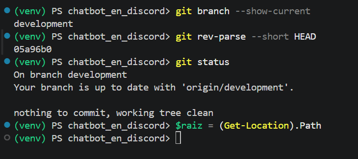

- **Importante:** la variable `$raiz` existe solo en la terminal donde se ejecutó este paso. Si se cierra o se abre otra terminal, hay que repetirlo (incluido el procedimiento A, porque la terminal nueva puede traer variables de sesión); sin `$raiz`, TC-RUT-01 falla porque `"$raiz\src"` se convierte en `\src`.

### 5.1 Procedimientos

**A. Eliminar las variables de sesión.** Una variable ya definida en la terminal tiene prioridad sobre el `.env` (ver OBS-01) y puede ocultar lo que cada caso quiere probar (por ejemplo, las variables `DB_*` en TC-RUT-02 o el valor por defecto de `EMBEDDINGS_MODELO` en TC-CFG-01). El procedimiento borra de la sesión todas las variables escritas en el `.env`, salvo `PYTHONPATH` (Python la lee al arrancar, así que cargarla después desde el `.env` ya no tiene efecto), y también las `LOG_LEVEL_<LOGGER>`. Se aplica en el paso 0, cada vez que se abre una terminal nueva y antes de cada caso que dependa del `.env`. Nunca se imprimen los valores (pueden ser contraseñas o tokens): solo los nombres.

```powershell
# Nombres de las variables escritas en el .env (sin valores y sin PYTHONPATH).
$nombresEnv = Get-Content .env |
    Where-Object { $_ -match '^\s*[A-Za-z_][A-Za-z0-9_]*\s*=' } |
    ForEach-Object { ($_ -split '=', 2)[0].Trim() } |
    Where-Object { $_ -ne "PYTHONPATH" }

# Borra esas variables de la sesión actual (no modifica el archivo .env).
# -ErrorAction SilentlyContinue: si alguna no existe, no muestra error.
$nombresEnv | ForEach-Object { Remove-Item "Env:$_" -ErrorAction SilentlyContinue }

# Borra también las LOG_LEVEL_<LOGGER>, aunque no estén escritas en el .env en ese momento.
Remove-Item Env:LOG_LEVEL* -ErrorAction SilentlyContinue

# Muestra los nombres que sigan definidos en la sesión. No debe mostrar nada.
Get-ChildItem Env: | Where-Object { $_.Name -like "LOG_*" -or $nombresEnv -contains $_.Name } | Select-Object Name
```

**B. Contar líneas `DEBUG` por archivo en la ejecución más reciente.** Se usa en los casos que ejecutan `main_offline.py` y revisan el contenido de los logs: TC-LOG-01 a TC-LOG-04 y TC-LOG-06. Define la variable `$carpeta`, que TC-LOG-03 reutiliza en sus pasos 3 y 4:

```powershell
# Busca, dentro de logs/, la carpeta logs_* modificada más recientemente (la de la última ejecución)
# y la guarda en la variable $carpeta. El filtro "logs_*" evita elegir por error una carpeta csv_*,
# que el programa también crea dentro de logs/ en cada ejecución.
$carpeta = Get-ChildItem logs -Directory -Filter "logs_*" | Sort-Object LastWriteTime -Descending | Select-Object -First 1

# Muestra el nombre de esa carpeta, para confirmar que es de la ejecución actual.
$carpeta.Name

# Para cada archivo .txt de esa carpeta, escribe "nombre: cantidad de líneas que contienen DEBUG".
Get-ChildItem $carpeta.FullName -Filter *.txt | ForEach-Object {
    "{0}: {1}" -f $_.Name, @(Select-String -Path $_.FullName -Pattern "DEBUG" -SimpleMatch).Count
}
```

**C. Antes de una ejecución completa que debe partir de cero:** borrar la base de datos de prueba y la carpeta de la base vectorial (la que indica `CHROMA_DIR`; por defecto, `chroma/`). No confundir con la caché de Hugging Face, que guarda el modelo de embeddings y no se borra. Se hace a mano, con la ejecución del programa detenida:

  1. **Carpeta `chroma/`** (en VS Code): en el Explorador (lista de archivos del costado izquierdo), buscar en la raíz del proyecto la carpeta `chroma` (el nombre que indica `CHROMA_DIR`), clic derecho → *Eliminar* y confirmar. Si no existe (primera ejecución), no hay nada que borrar.
  2. **Base de datos** (en pgAdmin 4): en el panel izquierdo, *Servers* → *PostgreSQL 18* → *Databases* → `base_de_conocimiento_chatbot_demo` (el valor de `DB_NAME` en el `.env`; verificar el nombre antes de borrar, para no eliminar otra base) → clic derecho → *Delete* (*Drop*) → confirmar con *Yes*. Si pgAdmin avisa que la base tiene conexiones abiertas, cerrar la terminal o el programa que la usa y repetir. No hay que volver a crearla a mano: el programa la crea al arrancar: `main_offline.py` llama a `crear_base_de_datos_si_no_existe` (`src/database/crear_bdd_e_inicializarla.py`), que consulta si existe y, si no, llama a `crear_base_de_datos` (`CREATE DATABASE`).
  3. **Comprobar que partió de cero:** en la ejecución, Alembic debe mostrar `Running upgrade -> <revisión>, crear_tablas_iniciales` (esta línea se usa como evidencia en los casos de logs). Si la base se había borrado, `log_persistencia_de_datos.txt` también debe tener la línea `Creando base de datos base_de_conocimiento_chatbot_demo...` (es de nivel `INFO`, por lo que no aparece con `LOG_LEVEL=WARNING`).
  4. **Git:** el `.gitignore` incluye las reglas `.env`, `.env.*` y `chroma/` (también `logs/`, `venv/` y `chroma_demo/`), por lo que ni el `.env` ni la base vectorial llegan a un commit. Las variantes que no empiezan con `.env.` (por ejemplo `.envi`) no están cubiertas (ver OBS-02; en el commit `269318d`, posterior al probado, las dos reglas se reemplazaron por `.env*`). Se comprueba con `git check-ignore -v .env chroma` (una línea por cada ruta; sin salida para una ruta = no está ignorada).

     Comprobado el 20/11/2026 (18:05, rama `development`):

     ```
     .gitignore:2:.env       .env
     .gitignore:10:chroma/   chroma
     ```

     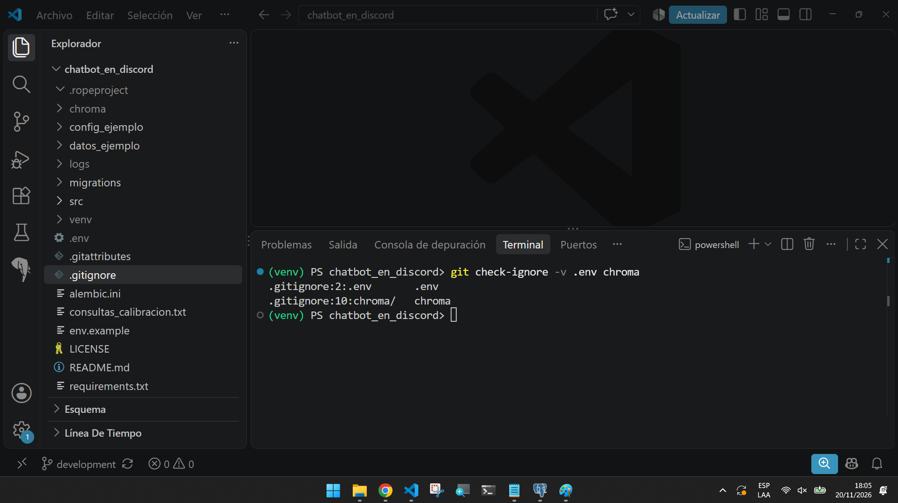

  Se aplica en TC-INT-01, TC-LOG-01 a TC-LOG-04, TC-RUT-04 y, **una sola vez antes de la primera ejecución**, en TC-LOG-06 (entre sus dos ejecuciones no se aplica, porque la segunda necesita encontrar la base con datos). No se aplica en TC-RUT-05 ni en TC-INT-02, porque el programa se detiene antes de procesar datos.

**D. Restaurar el `.env` base** al terminar cada caso que lo modifica: `JSON_DIR=datos_ejemplo`, `CONFIG_DIR=config_ejemplo`, `LOG_DIR=logs`, `LOG_LEVEL=INFO`, `EMBEDDINGS_MODELO=BAAI/bge-m3`; y borrar las líneas temporales que se hayan agregado (`LOG_LEVEL_CARGA_DB`, `LOG_LEVEL_CARGA_DBB`, etc.). Si el caso no modifica el `.env`, no se aplica.

**E. Verificar la conexión y el modelo de embeddings** (antes de las ejecuciones completas):

```powershell
# True si el equipo resuelve el nombre huggingface.co (hay internet); False si no.
[bool](Resolve-DnsName huggingface.co -ErrorAction SilentlyContinue)

# True si el modelo ya está descargado en la caché local de Hugging Face.
Test-Path "$HOME\.cache\huggingface\hub\models--BAAI--bge-m3"
```

- Primer resultado `True`: se puede ejecutar. Si el modelo no está en la caché (segundo resultado `False`), la primera ejecución lo descarga y tarda más.
- Primer resultado `False` y segundo `True`: no ejecutar sin más, porque el programa falla tras unos 3 minutos de reintentos (OBS-03). Con el modo sin conexión (abajo) se puede ejecutar: se verificó el 21/11/2026 (ver OBS-03). Si se usa, anotarlo en el campo «Observaciones» del caso.
- Ambos `False`: el caso queda ⛔ Bloqueada hasta tener conexión.
- Si el modelo ya se descargó pero el segundo resultado da `False`, revisar si están definidas `HF_HOME` o `HF_HUB_CACHE`, que cambian la carpeta de la caché.
- `Test-Path` solo comprueba que la carpeta del modelo exista, no que esté completa.

Modo sin conexión (solo con el modelo en la caché; verificado en OBS-03):

```powershell
# Indica a Hugging Face que no consulte internet y use solo lo ya descargado (vale solo para esta terminal).
$env:HF_HUB_OFFLINE = "1"

# ... ejecutar el caso ...

# Al terminar, elimina la variable para que no afecte a los casos siguientes.
Remove-Item Env:HF_HUB_OFFLINE
```

### 5.2 Qué hace cada comando

| Comando | Qué hace |
|---|---|
| `cd $env:TEMP` | `cd` cambia de carpeta. `$env:TEMP` es una variable de Windows con la ruta de la carpeta temporal. Sirve para ejecutar desde un lugar distinto al del proyecto. |
| `python -c "..."` | Ejecuta el código Python escrito entre comillas, sin crear un archivo. |
| `sys.path.insert(0, r'...\src')` | Dentro del `python -c`. Agrega la carpeta `src` al principio de `sys.path` (ver glosario), para que Python encuentre los módulos del proyecto aunque se ejecute desde otra carpeta. La `r` antes de las comillas hace que las `\` se lean tal cual. |
| `from utils.config_paths import ...` | Importa del proyecto la raíz y las rutas ya calculadas. |
| `print(...)` | Muestra un valor en pantalla. |
| `Get-Content .env` | Lee el archivo `.env` línea por línea. Se usa solo dentro del procedimiento A, que se queda con los nombres: ejecutado solo, imprimiría contraseñas y tokens. |
| `-match '^\s*[A-Za-z_][A-Za-z0-9_]*\s*='` | Se queda con las líneas que tienen la forma `NOMBRE=valor` y descarta comentarios y líneas vacías. |
| `($_ -split '=', 2)[0].Trim()` | Corta la línea en el primer `=` y se queda con lo de la izquierda (el nombre), sin espacios. |
| `Remove-Item "Env:$_"` | Borra de la sesión la variable cuyo nombre está en `$_`. `Env:` es la «carpeta» de PowerShell donde viven las variables de entorno. El archivo `.env` no se toca. |
| `Remove-Item Env:LOG_LEVEL*` | Borra `LOG_LEVEL` y las de cada logger. El `*` reemplaza cualquier texto. |
| `Get-ChildItem Env:` | Lista todas las variables de entorno de la sesión. |
| `Where-Object { ... }` | Se queda solo con los elementos que cumplen la condición entre llaves; `$_` es el elemento que se está revisando. |
| `-like "LOG_*"` · `-contains` | Condiciones de `Where-Object`: `-like` compara con un patrón (`*` = cualquier texto) y `-contains` pregunta si una lista incluye el valor. |
| `Select-Object Name` | Muestra solo la columna `Name`, para no imprimir los valores de las variables. |
| `Resolve-DnsName huggingface.co` | Pide a Windows la dirección de `huggingface.co`. Si falla, no hay internet. |
| `[bool](...)` | Convierte el resultado en `True` (hay resultado) o `False` (no hay). |
| `Test-Path "$HOME\.cache\huggingface\hub\models--BAAI--bge-m3"` | `$HOME` es tu carpeta de usuario. Comprueba si el modelo ya está descargado en la caché de Hugging Face. |
| `$env:HF_HUB_OFFLINE = "1"` | Crea una variable de sesión que le indica a Hugging Face que no use internet. Se elimina con `Remove-Item Env:HF_HUB_OFFLINE`. |
| `Get-ChildItem logs -Directory -Filter "logs_*"` | Lista las carpetas dentro de `logs/` cuyo nombre empieza con `logs_` (deja afuera las `csv_*`). |
| `Sort-Object LastWriteTime -Descending` | Las ordena de la más nueva a la más vieja. |
| `Select-Object -First 1` | Se queda con la primera, es decir, la más reciente. |
| `$carpeta = ...` | Guarda el resultado en una variable llamada `carpeta`. |
| `\|` (pipe) | Pasa el resultado de un comando como entrada del siguiente. |
| `ForEach-Object { ... }` | Repite lo que está entre llaves para cada elemento (cada archivo). |
| `Select-String -Pattern "DEBUG" -SimpleMatch` | Busca la palabra `DEBUG` como texto literal dentro de un archivo. |
| `.Count` | Cuenta cuántas líneas coincidieron. |
| `"{0}: {1}" -f a, b` | `-f` rellena una plantilla: `{0}` se reemplaza por `a` y `{1}` por `b`. Ejemplo: `"{0}: {1}" -f "log.txt", 5` escribe `log.txt: 5`. |
| `nivel_de_logger('carga_db')` | Calcula el nivel del logger `carga_db` según el `.env`. Devuelve un número: 10 = DEBUG, 20 = INFO, 30 = WARNING, 40 = ERROR, 50 = CRITICAL. |
| `Test-Path ruta` | Responde `True` si la carpeta o archivo existe y `False` si no. |
| `$LASTEXITCODE` | Código con el que terminó el último programa: `0` = terminó bien, otro número = terminó con error. |
| `New-Item -ItemType Directory nombre` | Crea una carpeta. |
| `Remove-Item ruta` | Borra un archivo o una carpeta vacía. |
| `python src\main_offline.py` | Ejecuta la carga offline: lee los JSON, guarda en PostgreSQL y construye la base vectorial. |
| `$_` | Dentro de `ForEach-Object`, es el elemento actual (en este caso, cada archivo). |
| `@( ... )` | Fuerza que el resultado sea una lista, para que `.Count` funcione aunque haya 0 o 1  coincidencias. |
| `Get-ChildItem $carpeta.FullName -Filter *.txt` | Lista los archivos `.txt` de la carpeta guardada en `$carpeta` (`.FullName` es su ruta completa). |
| `Select-Object Filename, Line` | Muestra solo dos columnas: el nombre del archivo y la línea de texto que coincidió. Si la línea es más larga que la terminal, se corta con `...`. |
| `;` | Separa dos instrucciones en la misma línea. Así, si al copiar un comando se pierde un salto de línea, las instrucciones siguen separadas. |
| `if ($carpeta) { ... } else { ... }` | Ejecuta lo que está en las primeras llaves solo si `$carpeta` tiene un valor (se encontró una carpeta de logs); si no, ejecuta lo de `else`. |
| `Write-Host "texto"` | Escribe el texto en la pantalla. |

### 5.3 Capturas de pantalla (evidencia)

- Tapar las rutas del equipo (usuario, carpetas personales) con un recuadro **sólido**; un desenfoque o pixelado a veces se puede revertir.
- El prompt ya no muestra usuario ni ruta completa, gracias al perfil de PowerShell (ver sección 2); solo aparece el nombre de la carpeta actual, por ejemplo `PS Temp>`.
- En la evidencia de texto se reemplaza la ruta por `<RUTA_DEL_PROYECTO>`.
- La terminal trae cargado el `.env` completo, con contraseñas y tokens: nunca listar las variables con sus valores (`Get-ChildItem Env:` a secas o `Get-Content .env` a secas). Usar `Select-Object Name` o los comandos de los procedimientos, que muestran solo nombres.
- Al abrir una terminal nueva, VS Code escribe la línea de activación del entorno virtual con la ruta completa (`...\Users\<usuario>\...\Activate.ps1`). Antes de ejecutar un caso, limpiar la pantalla con `Clear-Host` para que la captura no la incluya.
- No capturar la terminal desde la carpeta personal: el prompt mostraría el nombre de usuario (`PS <usuario>>`).

---

## 6. Casos de prueba: rutas

### TC-RUT-01: La raíz del proyecto se detecta desde otra carpeta

- **Objetivo:** comprobar que las rutas no dependen de la carpeta desde la que se ejecuta Python.
- **Precondiciones:** entorno virtual activo; `alembic.ini` presente en la raíz del proyecto; sesión preparada (paso 0), con `$raiz` definida en esta misma terminal.
- **Pasos:**
  1. Ir a una carpeta distinta de la del proyecto.
  2. Ejecutar el programa de comprobación (ajustar la ruta a la copia local del proyecto).
  3. Volver a la carpeta del proyecto.

  ```powershell
  # 1. Cambia a la carpeta temporal de Windows (fuera del proyecto).
  cd $env:TEMP

  # 2. Ejecuta Python pasándole la ruta de src como argumento ("$raiz\src"), que el código lee con sys.argv[1].
  #    Imprime: la raíz detectada, la carpeta de logs y si existe alembic.ini.
  python -c "import sys; sys.path.insert(0, sys.argv[1]); from utils.config_paths import RAIZ_PROYECTO, LOG_DIR_ABS, ALEMBIC_INI; print(RAIZ_PROYECTO); print(LOG_DIR_ABS); print(ALEMBIC_INI.exists())" "$raiz\src"

  # 3. Vuelve a la raíz del proyecto.
  cd $raiz
  ```

- **Resultado esperado:** imprime la raíz del proyecto, `<raíz>\logs` y `True`, aunque el directorio actual sea `Temp`.
- **Resultado obtenido:** coincide con lo esperado.
- **Estado:** ✅ Pasó
- **Ejecución:** 17/11/2026 · commit `05a96b0` · rama `development`
- **Evidencia:**
  ```
  <RUTA_DEL_PROYECTO>
  <RUTA_DEL_PROYECTO>\logs
  True
  ```

  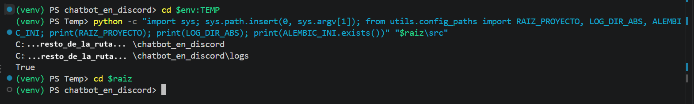

  En la captura, el inicio de la ruta se reemplazó por `...resto_de_la_ruta...` para no mostrar el usuario del equipo.

### TC-RUT-02: Aviso claro cuando falta el `.env`

- **Objetivo:** comprobar que, sin `.env`, el sistema avisa y falla con un mensaje comprensible.
- **Precondiciones:** sesión preparada (paso 0) **antes** de renombrar el `.env` (`.envi` no está ignorado por Git y aparece como archivo nuevo, por lo que `git status` deja de decir «clean» hasta restaurar el nombre `.env`); entorno virtual activo; procedimiento A aplicado **antes** de renombrar el `.env` (A lee los nombres desde ese archivo; si las variables `DB_*` siguieran en la sesión, el programa no fallaría por falta de datos de conexión).
- **Pasos:**
  1. Renombrar el `.env` a `.envi`.
  2. Ejecutar `python src\main_offline.py`.
  3. Restaurar el nombre `.env` y comprobarlo.

  ```powershell
  # 1. Renombra .env a .envi, para que el programa no lo encuentre.
  Rename-Item .env .envi

  # 2. Ejecuta el programa sin .env.
  python src\main_offline.py

  # 3. Restaura el nombre original y comprueba el resultado (.env = True, .envi = False).
  Rename-Item .envi .env
  Test-Path .env
  Test-Path .envi
  ```

- **Resultado esperado:** aparece un `UserWarning` con la ruta donde se esperaba el `.env`; `main_offline.py` se detiene con un error que indica que faltan los datos de conexión.
- **Resultado obtenido:** coincide con lo esperado. Con el `.env` renombrado a `.envi`, `main_offline.py` muestra primero el `UserWarning` con la ruta donde esperaba el `.env` y luego se detiene con `ValueError: Faltan datos de conexión a la base de datos. Verificá el archivo .env`.
- **Estado:** ✅ Pasó
- **Ejecución:** 17/11/2026 · commit `05a96b0` · rama `development`
- **Evidencia:**
  ```
  ...\src\utils\config_paths.py:34: UserWarning: No se encontró el archivo .env en <RUTA_DEL_PROYECTO>\.env. Copiá env.example a .env y completalo.
  ...
  ValueError: Faltan datos de conexión a la base de datos. Verificá el archivo .env
  ```

  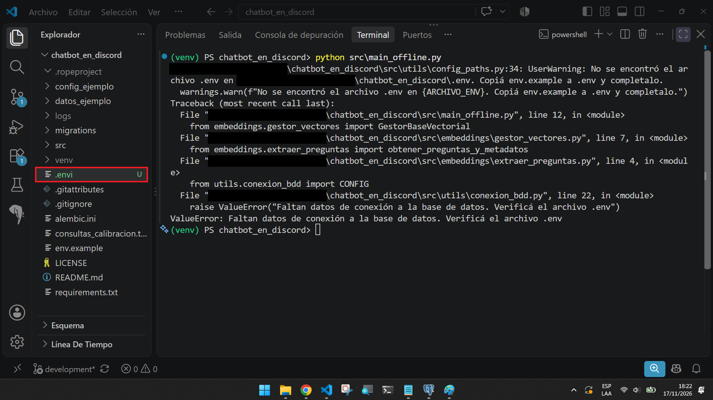

  Notas sobre la captura:
  - Las barras negras cubren el inicio de cada ruta (usuario y carpeta del equipo); el resto del texto es la salida original.
  - El recuadro rojo se agregó para señalar el archivo renombrado (`.envi`); en la carpeta ya no está `.env`.
  - El reloj de la barra de tareas muestra la fecha y la hora de la ejecución.
  - La letra `U` junto a `.envi` y el asterisco en `development*` aparecen porque Git ve `.envi` como un archivo nuevo; no hay cambios en el código (ver OBS-02).

  Restauración del `.env`:

  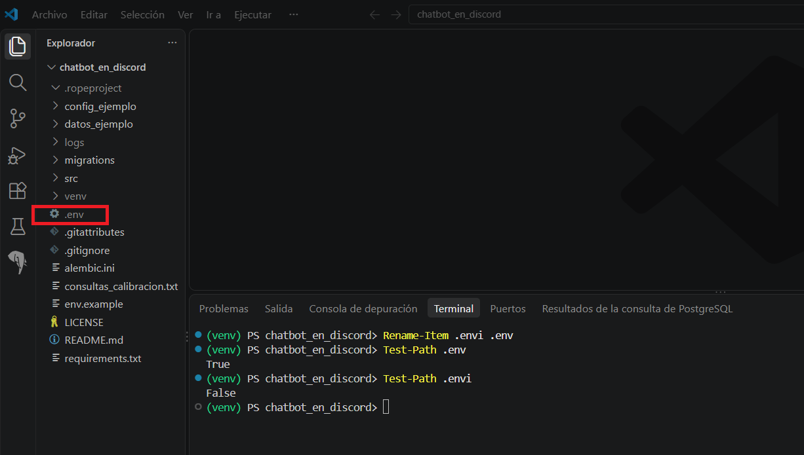

  El recuadro rojo se agregó para señalar el archivo `.env` restaurado.

### TC-RUT-03: `LOG_DIR` con ruta absoluta

- **Objetivo:** comprobar que una ruta absoluta en el `.env` se respeta tal cual y que la carpeta se crea sola.
- **Precondiciones:** criterio de entrada general; procedimiento A aplicado; la carpeta `C:\temp_logs_prueba` no existe de antes (si existe, borrarla: de lo contrario no se podría comprobar que el programa la crea).
- **Pasos:**
  1. En el `.env`, poner `LOG_DIR=C:/temp_logs_prueba`.
  2. Ejecutar:
     ```powershell
     # Antes de empezar: debe dar False (la carpeta todavía no existe).
     Test-Path C:\temp_logs_prueba

     # Importa las rutas del proyecto e imprime la carpeta de logs resuelta.
     python -c "import sys; sys.path.insert(0,'src'); from utils.config_paths import LOG_DIR_ABS; print(LOG_DIR_ABS)"

     # Responde True si la carpeta existe.
     Test-Path C:\temp_logs_prueba

     # Limpieza: borra la carpeta de prueba (está vacía).
     Remove-Item C:\temp_logs_prueba
     ```
  3. Aplicar el procedimiento D.
- **Resultado esperado:** imprime `C:\temp_logs_prueba` (sin mezclarla con la raíz del proyecto) y `Test-Path` devuelve `True`.
- **Resultado obtenido:** coincide con lo esperado. El primer `Test-Path` dio `False` (la carpeta no existía), el comando de Python imprimió `C:\temp_logs_prueba` sin errores y el segundo `Test-Path` dio `True`. El Explorador de Windows muestra `temp_logs_prueba` dentro de `OS (C:)`, con fecha de modificación 20:48. En la limpieza, `Remove-Item` borró la carpeta sin pedir confirmación (estaba vacía) y un tercer `Test-Path` dio `False`.
- **Estado:** ✅ Pasó
- **Ejecución:** 20/11/2026 (20:48 a 20:56) · commit `05a96b0` · rama `development`
- **Evidencia:**
  ```
  PS> Test-Path C:\temp_logs_prueba
  False
  PS> python -c "import sys; sys.path.insert(0,'src'); from utils.config_paths import LOG_DIR_ABS; print(LOG_DIR_ABS)"
  C:\temp_logs_prueba
  PS> Test-Path C:\temp_logs_prueba
  True
  PS> Remove-Item C:\temp_logs_prueba
  PS> Test-Path C:\temp_logs_prueba
  False
  ```

  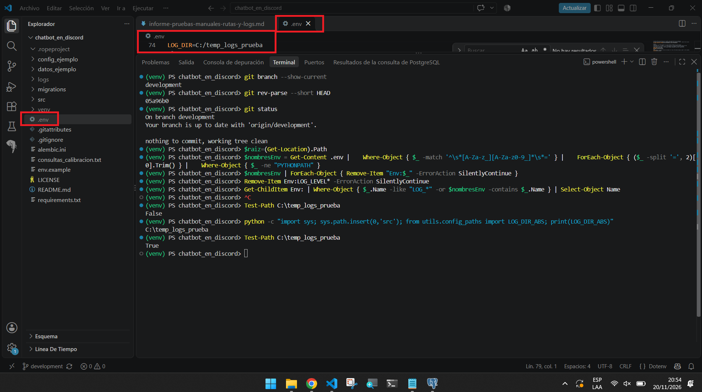

  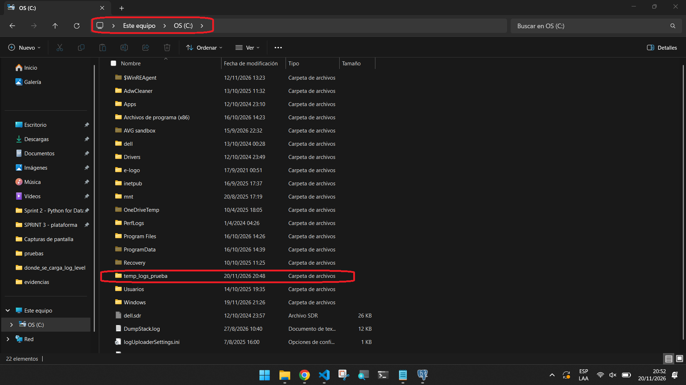

  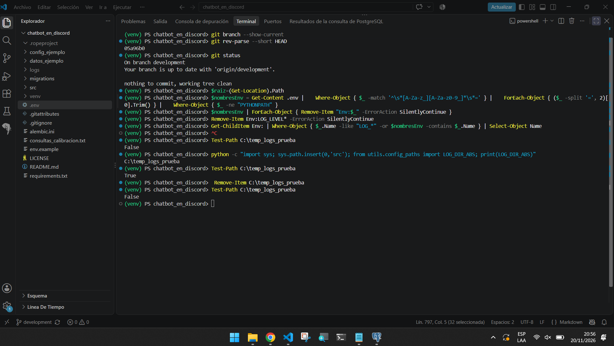

  Notas sobre las capturas:
  - Primera captura (20:54): paso 0 (rama `development`, commit `05a96b0`, repositorio limpio, `$raiz`), procedimiento A (la verificación no muestra ningún nombre) y los pasos del caso hasta el segundo `Test-Path` (`True`). Los recuadros rojos señalan el archivo `.env` y la línea `LOG_DIR=C:/temp_logs_prueba` en el editor.
  - Segunda captura (20:52): el Explorador de Windows con la carpeta `temp_logs_prueba` en `OS (C:)` (recuadro rojo), creada a las 20:48.
  - Tercera captura (20:56): la misma terminal, ya con la limpieza (`Remove-Item`) y el `Test-Path` final en `False`. La terminal se desplazó, por eso el comienzo del paso 0 no se ve completo.
- **Observaciones:**
  - La ruta se escribió con barras (`C:/temp_logs_prueba`) y se imprimió con barras invertidas (`C:\temp_logs_prueba`): el código la normaliza al formato de Windows.
  - La ruta impresa no incluye la raíz del proyecto, por lo que una ruta absoluta no se concatena con ella. En el Explorador de VS Code tampoco apareció ninguna carpeta nueva dentro del proyecto.
  - A diferencia de TC-RUT-06, el caso comprueba explícitamente que la carpeta no existía antes del paso 2 (primer `Test-Path` en `False`).
  - La fecha de modificación de la carpeta (20:48) indica cuándo se creó, y es anterior a la captura del Explorador (20:52).
  - Las capturas no muestran el procedimiento D (volver a `LOG_DIR=logs`); conviene confirmarlo antes del caso siguiente con `Select-String -Path .env -Pattern '^LOG_DIR='`.

### TC-RUT-04: Ejecución completa desde otra carpeta

- **Objetivo:** comprobar que el programa completo (incluidas las migraciones) funciona aunque se lo ejecute desde una carpeta distinta de la del proyecto, y que los logs se escriben en la raíz del proyecto.
- **Precondiciones:** criterio de entrada general y adicional; procedimiento C aplicado; procedimiento E aplicado; procedimiento A aplicado.
- **Pasos:**
  ```powershell
  # 1. Cambia a la carpeta temporal de Windows (fuera del proyecto).
  cd $env:TEMP

  # 2. Ejecuta el programa indicando la ruta completa del script (ajustar a la copia local).
  python <RUTA_DEL_PROYECTO>\src\main_offline.py

  # 3. Comprueba que NO se creó una carpeta logs en Temp (debe dar False).
  Test-Path $env:TEMP\logs

  # 4. Vuelve a la carpeta del proyecto.
  cd <RUTA_DEL_PROYECTO>

  # 5. Busca la carpeta de logs más reciente de la raíz del proyecto y muestra su nombre y fecha.
  $carpeta = Get-ChildItem logs -Directory -Filter "logs_*" | Sort-Object LastWriteTime -Descending | Select-Object -First 1
  $carpeta | Select-Object Name, LastWriteTime

  # 6. Cuenta los archivos de esa carpeta (deben ser 9).
  (Get-ChildItem $carpeta.FullName).Count

  # 7. Busca la línea de creación de la base de datos (solo imprime la línea, sin la ruta).
  Select-String -Path "$($carpeta.FullName)\log_persistencia_de_datos.txt" -Pattern "Creando base de datos" -SimpleMatch | ForEach-Object { $_.Line }
  ```
- **Resultado esperado:** el programa termina como en TC-INT-01; se crea una carpeta nueva dentro de `<raíz>\logs` con 9 archivos; el paso 3 devuelve `False`; como la base no existía, `log_persistencia_de_datos.txt` contiene la línea `Creando base de datos ...`.
- **Resultado obtenido:** coincide con lo esperado. Desde `$env:TEMP` el programa arrancó, Alembic creó las tablas sobre una base inexistente y terminó sin errores en consola. `Test-Path $env:TEMP\logs` devolvió `False`. Los logs se escribieron en la raíz del proyecto: carpeta `logs_20_11_26_19_43` (modificada el 20/11/2026 19:44:11) con 9 archivos, y la carpeta `chroma/` apareció en la raíz. `log_persistencia_de_datos.txt` registró la creación de la base a las 19:43:42.
- **Estado:** ✅ Pasó
- **Ejecución:** 20/11/2026 (19:40 a 19:56) · commit `05a96b0` · rama `development`
- **Evidencia:**
  ```
  PS Temp> python <RUTA_DEL_PROYECTO>\src\main_offline.py
  INFO  [alembic.runtime.migration] Context impl PostgresqlImpl.
  INFO  [alembic.runtime.migration] Will assume transactional DDL.
  INFO  [alembic.runtime.migration] Running upgrade  -> 23f57afc987c, crear_tablas_iniciales
  PS Temp> Test-Path $env:TEMP\logs
  False

  Name               LastWriteTime
  ----               -------------
  logs_20_11_26_19_43 20/11/2026 19:44:11

  9

  2026-11-20 19:43:42,276 - INFO - carga_db - Creando base de datos base_de_conocimiento_chatbot_demo...
  ```

  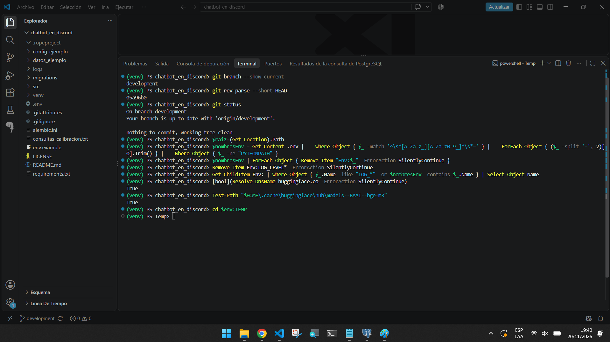

  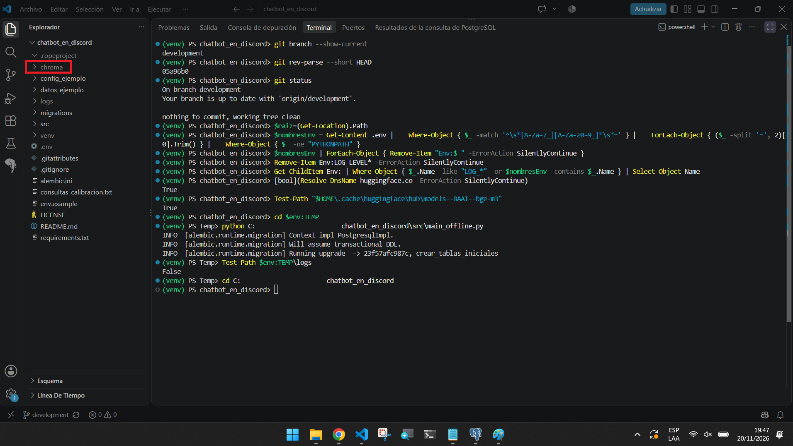

  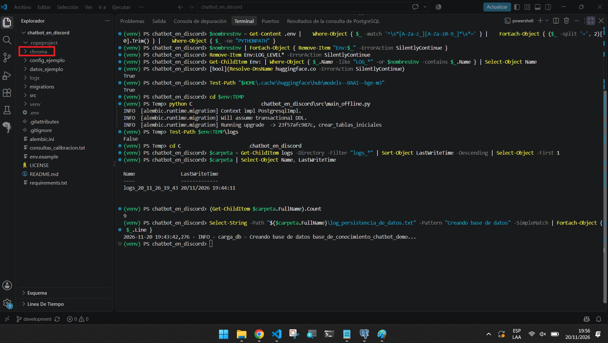

  Notas sobre las capturas:
  - Primera captura (19:40): paso 0 (rama `development`, commit `05a96b0`, repositorio limpio, `$raiz`), procedimiento A (la verificación no muestra ningún nombre), procedimiento E (`True` y `True`) y `cd $env:TEMP` (el prompt pasa a `PS Temp>`). El Explorador no tiene la carpeta `chroma/`: es la evidencia del procedimiento C (que se hace a mano, por eso no aparece en la terminal).
  - Segunda captura (19:47): la misma terminal, continuada. Se ve la ejecución, el `Test-Path`, el regreso a la carpeta del proyecto y, en el Explorador, la carpeta `chroma/` (recuadro rojo), que el programa creó en la raíz del proyecto y no en `Temp`.
  - Tercera captura (19:56): continuación de la misma terminal (el Explorador conserva `chroma/` con su recuadro rojo). Muestra los pasos 5 a 7. La hora de la carpeta de logs y la de la línea de creación de la base (19:43) coinciden con la de la ejecución.
  - Las barras negras cubren las rutas del script y de la carpeta del proyecto (usuario y carpeta del equipo).
- **Observaciones:**
  - La línea `Running upgrade -> ...` y la línea `Creando base de datos ...` indican que la base de datos no existía (procedimiento C) y que el programa la creó (ver `crear_base_de_datos_si_no_existe`).
  - Los pasos 5 a 7 se agregaron durante la ejecución: las dos primeras capturas mostraban que no se crearon logs en `Temp`, pero no que sí se crearon en la raíz.

### TC-RUT-05: Carpeta de datos inexistente

- **Objetivo:** comprobar que, si `JSON_DIR` apunta a una carpeta que no existe, el programa informa el error y **no** la crea.
- **Precondiciones:** criterio de entrada general; procedimiento A aplicado.
- **Pasos:**
  1. En el `.env`, poner `JSON_DIR=carpeta_que_no_existe`.
  2. Ejecutar:
     ```powershell
     # Ejecuta la carga offline con la configuración errónea.
     python src\main_offline.py

     # Comprueba que la carpeta NO se creó (debe dar False).
     Test-Path carpeta_que_no_existe
     ```
  3. Aplicar el procedimiento D.
- **Resultado esperado:** el programa se detiene con `FileNotFoundError: El directorio no existe: <RUTA_DEL_PROYECTO>\carpeta_que_no_existe` (un traceback, no un mensaje amigable); `Test-Path` devuelve `False`.
- **Resultado obtenido:** coincide con lo esperado. El programa se detuvo con un traceback que termina en `FileNotFoundError: El directorio no existe: <RUTA_DEL_PROYECTO>\carpeta_que_no_existe`, y `Test-Path` devolvió `False`: la carpeta no se creó.
- **Estado:** ✅ Pasó
- **Ejecución:** 20/11/2026 · commit `05a96b0` · rama `development`
- **Evidencia:**
  ```
  Traceback (most recent call last):
    File "<RUTA_DEL_PROYECTO>\src\main_offline.py", line 94, in <module>
      main()
    File "<RUTA_DEL_PROYECTO>\src\main_offline.py", line 32, in main
      rutas_json = buscador_archivos.obtener_rutas_json()
    File "<RUTA_DEL_PROYECTO>\src\utils\file_searcher.py", line 19, in obtener_rutas_json
      raise FileNotFoundError(f"El directorio no existe: {directorio_base}")
  FileNotFoundError: El directorio no existe: <RUTA_DEL_PROYECTO>\carpeta_que_no_existe

  Test-Path carpeta_que_no_existe
  False
  ```

  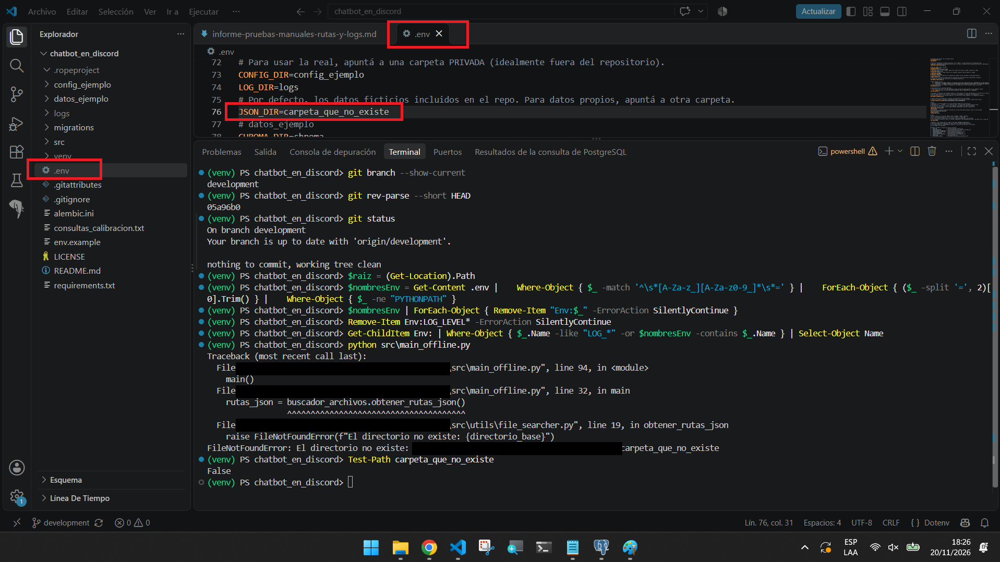

  Notas sobre la captura:
  - Se ven, en orden: el paso 0 (rama `development`, commit `05a96b0`, repositorio limpio, `$raiz`), el procedimiento A (la última verificación no muestra ningún nombre), la ejecución de `main_offline.py` con su error y el `Test-Path`.
  - Los recuadros rojos se agregaron para señalar el archivo `.env` y la línea `JSON_DIR=carpeta_que_no_existe` en el editor.
  - Las barras negras cubren el inicio de cada ruta (usuario y carpeta del equipo); el resto del texto es la salida original.
  - El reloj de la barra de tareas muestra la fecha y la hora de la ejecución (18:26 del 20/11/2026).
- **Observaciones:** el error se produce en `main()` (línea 32, al buscar los JSON), antes de la creación de la base de datos, por lo que este caso no depende del estado de la base ni de `chroma/` (el procedimiento C no es necesario; borrarlas antes no altera el resultado). El mensaje es un traceback de Python y no un aviso amigable, como se esperaba.

### TC-RUT-06: `LOG_DIR` se crea sola

- **Objetivo:** comprobar que la carpeta de logs se crea automáticamente si no existe.
- **Precondiciones:** criterio de entrada general; `LOG_DIR=logs`; procedimiento A aplicado.
- **Pasos:**
  ```powershell
  # 1. Renombra la carpeta logs para que "no exista" (así no se pierden los logs anteriores).
  Rename-Item logs logs_respaldo

  # 2. Importa las rutas del proyecto (esto debería crear logs/).
  python -c "import sys; sys.path.insert(0,'src'); from utils.config_paths import LOG_DIR_ABS; print(LOG_DIR_ABS)"

  # 3. Comprueba que logs existe de nuevo (debe dar True).
  Test-Path logs

  # 4. Limpieza: borra la carpeta nueva (vacía) y restaura la original.
  Remove-Item logs
  Rename-Item logs_respaldo logs
  ```
- **Resultado esperado:** el paso 3 devuelve `True`, sin errores.
- **Resultado obtenido:** coincide con lo esperado. Tras renombrar `logs` a `logs_respaldo`, el comando del paso 2 imprimió `<RUTA_DEL_PROYECTO>\logs` sin errores y el paso 3 devolvió `True`: la carpeta se creó sola y el Explorador mostró `logs` y `logs_respaldo` a la vez. En la limpieza, `Remove-Item logs` borró la carpeta nueva sin pedir confirmación (estaba vacía) y la carpeta original quedó restaurada.
- **Estado:** ✅ Pasó
- **Ejecución:** 20/11/2026 (20:28 a 20:30) · commit `05a96b0` · rama `development`
- **Evidencia:**
  ```
  PS> Rename-Item logs logs_respaldo
  PS> python -c "import sys; sys.path.insert(0,'src'); from utils.config_paths import LOG_DIR_ABS; print(LOG_DIR_ABS)"
  <RUTA_DEL_PROYECTO>\logs
  PS> Test-Path logs
  True
  PS> Remove-Item logs
  PS> Rename-Item logs_respaldo logs
  ```

  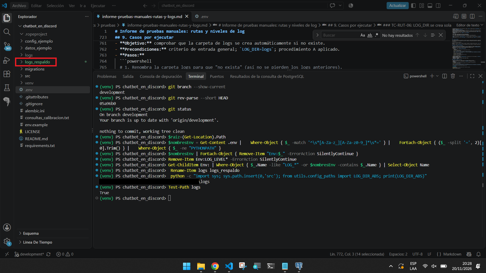

  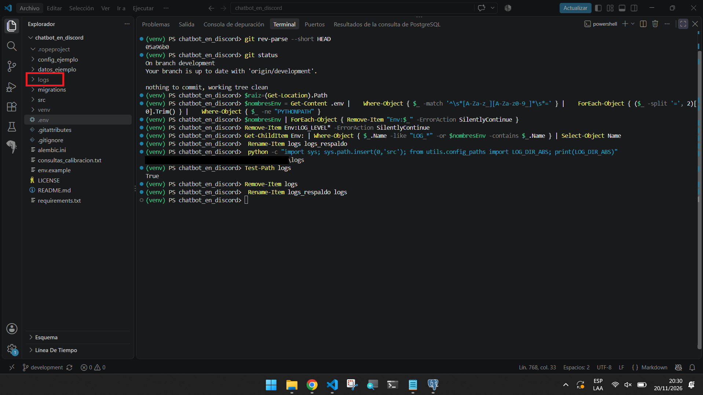

  Notas sobre las capturas:
  - Primera captura (20:28): paso 0 (rama `development`, commit `05a96b0`, repositorio limpio, `$raiz`), procedimiento A (la verificación no muestra ningún nombre) y los pasos 1 a 3. El recuadro rojo señala `logs_respaldo` en el Explorador.
  - Segunda captura (20:30): continuación de la misma terminal (por el desplazamiento, arriba se ve desde `git rev-parse`). Muestra los pasos 1 a 3 y la limpieza del paso 4. El recuadro rojo señala `logs` de nuevo, sin `logs_respaldo`.
  - Las barras negras cubren el inicio de la ruta impresa por Python (usuario y carpeta del equipo).
- **Observaciones:**
  - Mientras existe `logs_respaldo`, Git la muestra como carpeta nueva (punto verde en el Explorador, 365 cambios en el control de código fuente y `development*` en la barra de estado): el `.gitignore` ignora `logs/`, pero no `logs_respaldo/`. Al restaurar `logs`, el estado vuelve a quedar limpio (segunda captura). No hacer commits durante el caso.
  - El caso no comprueba que `logs` no existía justo antes del paso 2. Alcanza con que `Rename-Item` no haya dado error, porque mueve la carpeta; para dejarlo explícito se podría agregar `Test-Path logs` (debe dar `False`) entre los pasos 1 y 2.
  - La ruta impresa termina en `\logs`, lo que confirma que `LOG_DIR=logs` se resolvió respecto de la raíz del proyecto.

---

## 7. Casos de prueba: niveles de log

### TC-LOG-01: `LOG_LEVEL=INFO` no registra `DEBUG`

- **Objetivo:** comprobar que con nivel `INFO` ningún archivo de log contiene líneas `DEBUG`.
- **Precondiciones:** procedimiento A aplicado; `LOG_LEVEL=INFO` (o vacío) en el `.env`; procedimiento C aplicado; procedimiento E aplicado.
- **Pasos:**
  1. `python src\main_offline.py`
  2. Ejecutar el procedimiento B.
- **Resultado esperado:** `0` líneas `DEBUG` en todos los archivos; se conservan las líneas `INFO` y superiores.
- **Resultado obtenido:** la ejecución completa terminó sin errores y generó la carpeta `logs_20_11_26_12_52` con 9 archivos de log, todos con `0` líneas `DEBUG`. Siete de los nueve contienen líneas `INFO` (se conservan); los otros dos (`log_json_01.txt` y `log_preguntas_efectivamente_pesistidas_1.txt`) tienen `0` líneas `INFO`.
- **Estado:** ✅ Pasó
- **Ejecución:** 20/11/2026 · commit `05a96b0` · rama `development`
- **Evidencia:** carpeta `logs_20_11_26_12_52`:
  ```
  cargador_yaml.txt: 0
  logs_generacion_embeddings.txt: 0
  logs_preguntas_para_embeddings.txt: 0
  logs_procesar_mensajes.txt: 0
  log_json_01.txt: 0
  log_migraciones_alembic_automaticas.txt: 0
  log_persistencia_de_datos.txt: 0
  log_preguntas_efectivamente_pesistidas_1.txt: 0
  log_procesamiento_con_preguntas_cerradas.txt: 0
  ```

  Conteo de líneas `INFO` por archivo en la misma carpeta (misma terminal, 20/11/2026, 13:01), para comprobar que los logs tienen contenido y que `0` líneas `DEBUG` no se cumple de forma trivial:
  ```
  cargador_yaml.txt: 5
  logs_generacion_embeddings.txt: 1
  logs_preguntas_para_embeddings.txt: 1
  logs_procesar_mensajes.txt: 3
  log_json_01.txt: 0
  log_migraciones_alembic_automaticas.txt: 1
  log_persistencia_de_datos.txt: 11
  log_preguntas_efectivamente_pesistidas_1.txt: 0
  log_procesamiento_con_preguntas_cerradas.txt: 27
  ```

  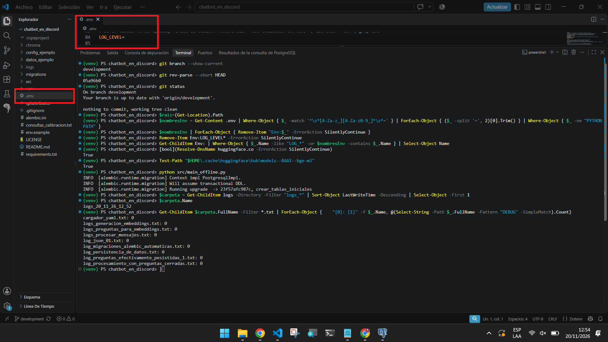

  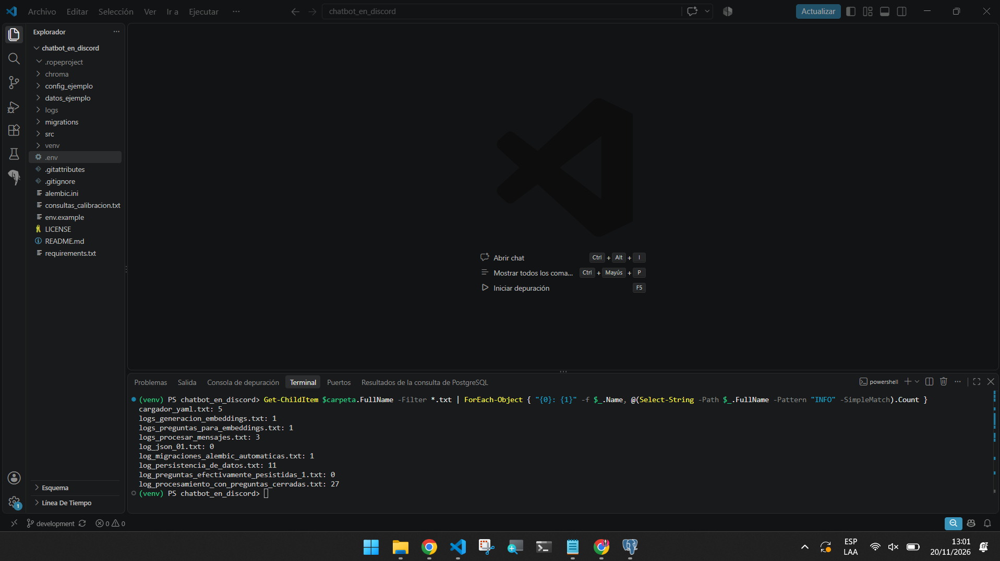

  Notas sobre la captura:
  - Se ven, en orden: el paso 0 (rama `development`, commit `05a96b0`, repositorio limpio), el procedimiento A (la última verificación no muestra ningún nombre), el procedimiento E (`True` y `True`), la ejecución de `main_offline.py` y el procedimiento B.
  - Los recuadros rojos se agregaron para señalar el archivo `.env` y la línea `LOG_LEVEL=` (vacía) en el editor.
  - El reloj de la barra de tareas muestra la fecha y la hora de la ejecución.
  - Las tres líneas `INFO [alembic...]` las imprime Alembic según `alembic.ini` (ver TC-INT-01).
  - En la segunda captura, `$carpeta` conserva la carpeta de la captura anterior (misma terminal); el reloj muestra 13:01 del 20/11/2026.
- **Observaciones:** los dos archivos con `0` líneas `INFO` no se escriben con un logger sino que el programa vuelca en ellos las preguntas y respuestas en texto plano (sin nivel), por lo que nunca tienen líneas `INFO`; para ellos, el `0` de `DEBUG` se cumple siempre y no depende del nivel configurado. Con `LOG_LEVEL` vacío se usa el nivel por defecto, `INFO`. El procedimiento A ya estaba aplicado, así que no había variables de sesión que alteraran el resultado (ver OBS-01).

### TC-LOG-02: `LOG_LEVEL=DEBUG` registra todo el detalle

- **Objetivo:** comprobar que el nivel `DEBUG` habilita los mensajes de detalle.
- **Precondiciones:** procedimiento A aplicado (variable de sesión eliminada); `LOG_LEVEL=DEBUG` en el `.env`; procedimiento C aplicado; procedimiento E aplicado.
- **Pasos:**
  1. Verificar el nivel que se lee:
     ```powershell
     # Calcula el nivel del logger "carga_db" según el .env e imprime el número (10 = DEBUG).
     python -c "import sys; sys.path.insert(0,'src'); from utils.utilidades_logs import nivel_de_logger; print(nivel_de_logger('carga_db'))"
     ```
  2. `python src\main_offline.py`
  3. Ejecutar el procedimiento B.
  4. Aplicar el procedimiento D.
- **Resultado esperado:** el paso 1 imprime `10`; los archivos con detalle (por ejemplo `logs_procesar_mensajes.txt` y `log_persistencia_de_datos.txt`) tienen líneas `DEBUG`.
- **Resultado obtenido:** el paso 1 imprimió `10`. La ejecución completa terminó sin errores y generó la carpeta `logs_20_11_26_13_21`; cuatro de sus nueve archivos tienen líneas `DEBUG`, entre ellos `logs_procesar_mensajes.txt` (110) y `log_persistencia_de_datos.txt` (206).
- **Estado:** ✅ Pasó
- **Ejecución:** 20/11/2026 · commit `05a96b0` · rama `development`
- **Evidencia:** carpeta `logs_20_11_26_13_21`; paso 1: `10`:
  ```
  cargador_yaml.txt: 0
  logs_generacion_embeddings.txt: 53
  logs_preguntas_para_embeddings.txt: 0
  logs_procesar_mensajes.txt: 110
  log_json_01.txt: 0
  log_migraciones_alembic_automaticas.txt: 0
  log_persistencia_de_datos.txt: 206
  log_preguntas_efectivamente_pesistidas_1.txt: 0
  log_procesamiento_con_preguntas_cerradas.txt: 7
  ```

  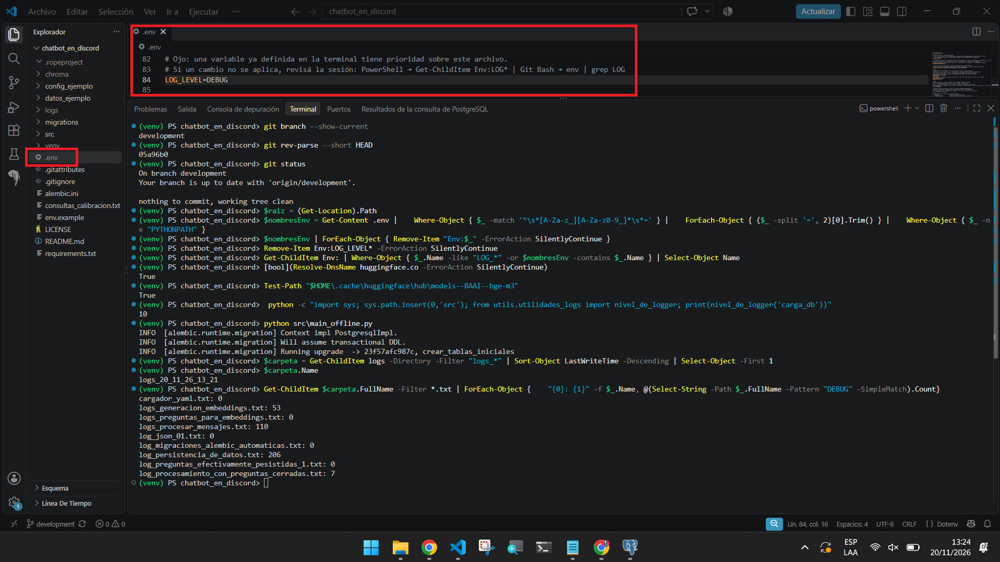

  Notas sobre la captura:
  - Se ven, en orden: el paso 0 (rama `development`, commit `05a96b0`, repositorio limpio), el procedimiento A (la última verificación no muestra ningún nombre), el procedimiento E (`True` y `True`), el paso 1 (`10`), la ejecución de `main_offline.py` y el procedimiento B.
  - Los recuadros rojos se agregaron para señalar el archivo `.env` y la línea `LOG_LEVEL=DEBUG` en el editor.
  - El reloj de la barra de tareas muestra la fecha y la hora de la ejecución.
- **Observaciones:** los cinco archivos con `0` líneas `DEBUG` no emitieron mensajes de ese nivel en esta ejecución; dos de ellos (`log_json_01.txt` y `log_preguntas_efectivamente_pesistidas_1.txt`) se escriben en texto plano, sin nivel (ver TC-LOG-01).

### TC-LOG-03: `LOG_LEVEL=WARNING` filtra `DEBUG` e `INFO`

- **Objetivo:** comprobar que con nivel `WARNING` solo se escriben avisos y errores.
- **Precondiciones:** procedimiento A aplicado; `LOG_LEVEL=WARNING` en el `.env`; procedimiento C aplicado; procedimiento E aplicado.
- **Pasos:**
  1. `python src\main_offline.py`
  2. Ejecutar el procedimiento B.
  3. Mostrar el tamaño de los archivos:
     ```powershell
     # Lista cada archivo .txt de la última ejecución con su tamaño en bytes (Length = 0 significa vacío).
     Get-ChildItem $carpeta.FullName -Filter *.txt | Select-Object Name, Length
     ```
  4. Contar las líneas `INFO` por archivo (el procedimiento B solo cuenta `DEBUG`):
     ```powershell
     # Para cada archivo .txt de la última ejecución, escribe "nombre: cantidad de líneas que contienen INFO".
     Get-ChildItem $carpeta.FullName -Filter *.txt | ForEach-Object { "{0}: {1}" -f $_.Name, @(Select-String -Path $_.FullName -Pattern "INFO" -SimpleMatch).Count }
     ```
  5. Aplicar el procedimiento D.
- **Resultado esperado:** ninguna línea `DEBUG` ni `INFO`; solo `WARNING`, `ERROR` o `CRITICAL`, si los hubiera.
- **Resultado obtenido:** la ejecución generó la carpeta `logs_20_11_26_13_40` con 9 archivos, todos con `0` líneas `DEBUG` y `0` líneas `INFO`. Los siete archivos escritos con un logger quedaron vacíos (0 bytes), porque la ejecución no produjo avisos ni errores. Los otros dos (`log_json_01.txt` y `log_preguntas_efectivamente_pesistidas_1.txt`, 11540 bytes cada uno) contienen texto plano sin nivel (ver TC-LOG-01), por lo que no están vacíos.
- **Estado:** ✅ Pasó (con limitación)
- **Ejecución:** 20/11/2026 · commit `05a96b0` · rama `development` (repetición con los procedimientos A y E aplicados; la primera ejecución fue el 13/11/2026)
- **Observaciones:**
  - Como no hubo eventos de nivel `WARNING`, no se pudo ver una línea de ese nivel escrita. Esa limitación se cubre en TC-LOG-06 (✅).
  - En la consola se ven tres líneas `INFO [alembic...]` aunque el nivel es `WARNING`: las imprime Alembic según `alembic.ini` y no dependen de `LOG_LEVEL` (ver TC-INT-01). No se escriben en los archivos de log.
  - Los dos archivos de texto plano tienen `0` líneas `INFO` y `DEBUG`: su contenido no tiene nivel, así que ese resultado no depende de `LOG_LEVEL`.
- **Evidencia:** carpeta `logs_20_11_26_13_40`:
  ```
  Conteo de líneas DEBUG: 0 en los 9 archivos
  Conteo de líneas INFO:  0 en los 9 archivos

  Tamaño en bytes (Length):
  cargador_yaml.txt                                0
  logs_generacion_embeddings.txt                   0
  logs_preguntas_para_embeddings.txt               0
  logs_procesar_mensajes.txt                       0
  log_json_01.txt                              11540
  log_migraciones_alembic_automaticas.txt          0
  log_persistencia_de_datos.txt                    0
  log_preguntas_efectivamente_pesistidas_1.txt 11540
  log_procesamiento_con_preguntas_cerradas.txt     0
  ```

  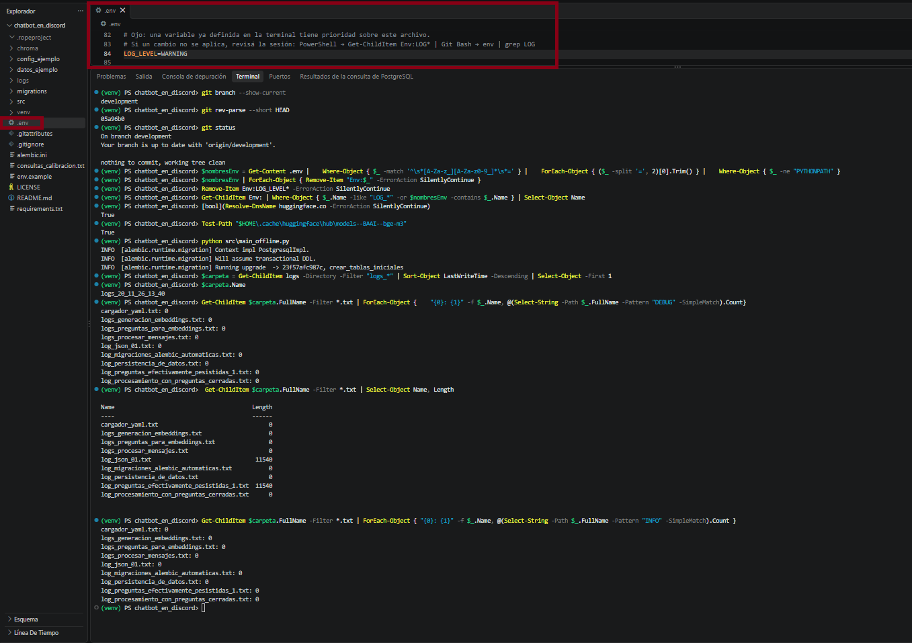

  Notas sobre la captura:
  - Se ven, en orden: el paso 0 (rama `development`, commit `05a96b0`, repositorio limpio), el procedimiento A (la última verificación no muestra ningún nombre), el procedimiento E (`True` y `True`), la ejecución de `main_offline.py`, el procedimiento B, los tamaños de los archivos y el conteo de líneas `INFO`.
  - Los recuadros rojos se agregaron para señalar el archivo `.env` y la línea `LOG_LEVEL=WARNING` en el editor.

### TC-LOG-04: Nivel propio para un logger

- **Objetivo:** comprobar que `LOG_LEVEL_<LOGGER>` tiene prioridad sobre `LOG_LEVEL` y afecta solo a ese logger.
- **Precondiciones:** procedimiento A aplicado; `.env` con `LOG_LEVEL=INFO` y `LOG_LEVEL_CARGA_DB=DEBUG`; procedimiento C aplicado; procedimiento E aplicado.
- **Pasos:**
  1. `python src\main_offline.py`
  2. Ejecutar el procedimiento B.
  3. Contar las líneas `INFO` por archivo (el procedimiento B solo cuenta `DEBUG`), con el comando del paso 4 de TC-LOG-03.
  4. Aplicar el procedimiento D (borra `LOG_LEVEL_CARGA_DB`).
- **Resultado esperado:** solo `log_persistencia_de_datos.txt` contiene líneas `DEBUG`; el resto queda en `0`. Las líneas `INFO` se conservan en los archivos con logger.
- **Resultado obtenido:** la ejecución completa terminó sin errores en consola y generó la carpeta `logs_20_11_26_17_19` con 9 archivos. Solo `log_persistencia_de_datos.txt` tiene líneas `DEBUG` (206); los otros ocho tienen `0`. Las líneas `INFO` coinciden con las de TC-LOG-01 (siete archivos con contenido, los dos de texto plano con `0`).
- **Estado:** ✅ Pasó
- **Ejecución:** 20/11/2026 · commit `05a96b0` · rama `development` (repetición con los procedimientos A y E aplicados; la primera ejecución fue el 13/11/2026)
- **Evidencia:** carpeta `logs_20_11_26_17_19`:
  ```
  Conteo de líneas DEBUG:
  cargador_yaml.txt: 0
  logs_generacion_embeddings.txt: 0
  logs_preguntas_para_embeddings.txt: 0
  logs_procesar_mensajes.txt: 0
  log_json_01.txt: 0
  log_migraciones_alembic_automaticas.txt: 0
  log_persistencia_de_datos.txt: 206
  log_preguntas_efectivamente_pesistidas_1.txt: 0
  log_procesamiento_con_preguntas_cerradas.txt: 0

  Conteo de líneas INFO:
  cargador_yaml.txt: 5
  logs_generacion_embeddings.txt: 1
  logs_preguntas_para_embeddings.txt: 1
  logs_procesar_mensajes.txt: 3
  log_json_01.txt: 0
  log_migraciones_alembic_automaticas.txt: 1
  log_persistencia_de_datos.txt: 11
  log_preguntas_efectivamente_pesistidas_1.txt: 0
  log_procesamiento_con_preguntas_cerradas.txt: 27
  ```

  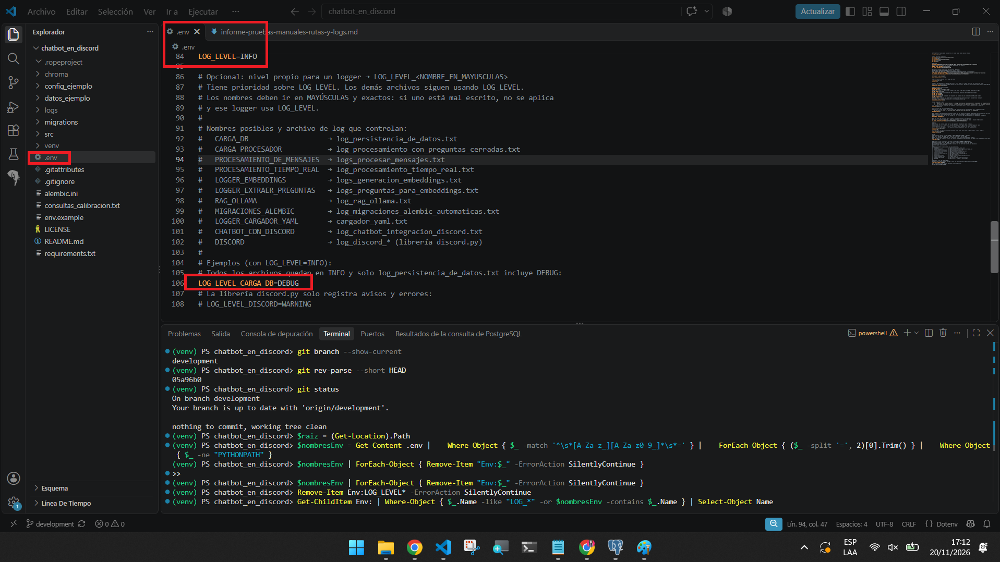

  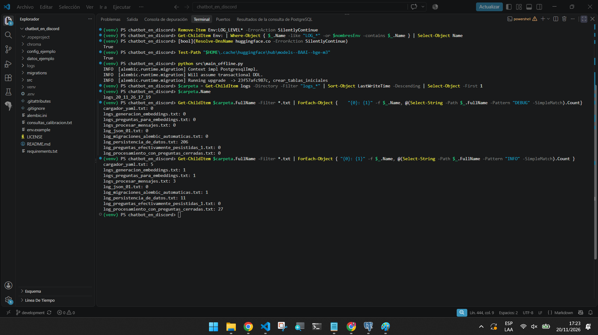

  Notas sobre las capturas:
  - Primera captura (reloj: 17:12 del 20/11/2026): el paso 0 (rama `development`, commit `05a96b0`, repositorio limpio, `$raiz`) y el procedimiento A. Los recuadros rojos se agregaron para señalar el archivo `.env`, la línea 84 (`LOG_LEVEL=INFO`) y la línea 106 (`LOG_LEVEL_CARGA_DB=DEBUG`). El primer intento de limpiar las variables dejó un prompt de continuación (`>>`) y se volvió a ejecutar la línea; no afecta el resultado.
  - Segunda captura (reloj: 17:23 del 20/11/2026): continuación en la misma terminal (la terminal se desplazó, por eso arriba se ve solo el final del procedimiento A). Muestra la verificación del procedimiento A (no muestra ningún nombre), el procedimiento E (`True` y `True`), la ejecución de `main_offline.py`, el nombre de la carpeta de logs y el conteo de `DEBUG` e `INFO` por archivo.
  - Las tres líneas `INFO [alembic...]` las imprime Alembic según `alembic.ini` (ver TC-INT-01). La línea `Running upgrade -> 23f57afc987c, crear_tablas_iniciales` indica que la base estaba vacía al empezar (procedimiento C aplicado).
  - Ambas capturas se hicieron antes de aplicar el procedimiento D.
- **Observaciones:**
  - El resultado no se cumple de forma trivial: con `LOG_LEVEL=DEBUG` (TC-LOG-02) tres de esos archivos sí tenían líneas `DEBUG` (`logs_generacion_embeddings.txt`: 53, `logs_procesar_mensajes.txt`: 110 y `log_procesamiento_con_preguntas_cerradas.txt`: 7). Aquí quedan en `0`, así que el nivel `INFO` global se aplicó a los demás loggers. Solo `log_persistencia_de_datos.txt` (logger `CARGA_DB`) conserva `DEBUG`, y con la misma cantidad que en TC-LOG-02 (206).
  - Los archivos `log_json_01.txt` y `log_preguntas_efectivamente_pesistidas_1.txt` se escriben en texto plano, sin nivel (ver TC-LOG-01), por lo que su `0` no depende de la configuración.

### TC-LOG-05: `LOG_LEVEL` vacío o inválido

- **Objetivo:** comprobar que un valor vacío o inválido no rompe el programa y se usa `INFO`.
- **Precondiciones:** procedimiento A aplicado (variable de sesión eliminada).
- **Pasos:**
  1. Con `LOG_LEVEL=PATATA` en el `.env`, ejecutar el comando de abajo.
  2. Con `LOG_LEVEL=` (vacío), ejecutarlo de nuevo.
  3. Aplicar el procedimiento D.
  ```powershell
  # Imprime el nivel numérico del logger carga_db (20 = INFO).
  python -c "import sys; sys.path.insert(0,'src'); from utils.utilidades_logs import nivel_de_logger; print(nivel_de_logger('carga_db'))"
  ```
- **Resultado esperado:** imprime `20` en ambos pasos.
- **Resultado obtenido:** coincide con lo esperado. Con `LOG_LEVEL=PATATA` (valor inválido) el comando imprimió `20`; con `LOG_LEVEL=` (vacío) también imprimió `20`. En ningún caso falló ni quedó sin nivel: se usó `INFO`. El paso 2 se ejecutó dos veces con el mismo resultado: la segunda, después de repetir el procedimiento A (ver observaciones).
- **Estado:** ✅ Pasó
- **Ejecución:** 21/11/2026 · commit `05a96b0` · rama `development`
- **Evidencia:**
  ```
  Paso 1, con LOG_LEVEL=PATATA en el .env:
  python -c "import sys; sys.path.insert(0,'src'); from utils.utilidades_logs import nivel_de_logger; print(nivel_de_logger('carga_db'))"
  20

  Paso 2, con LOG_LEVEL= (vacío) en el .env (mismo comando):
  20

  Paso 2 repetido, después de volver a aplicar el procedimiento A (mismo comando):
  20
  ```

  Captura 1: preparación y paso 1.

  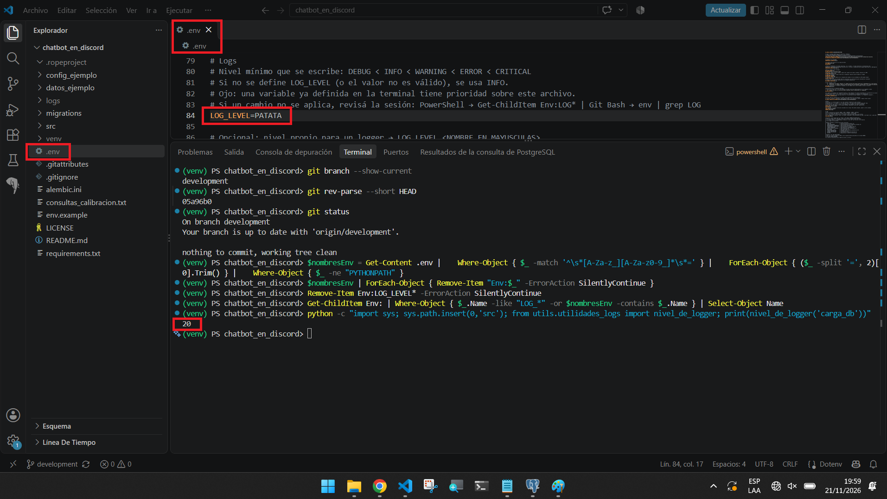

  Captura 2: paso 2 y repetición con el procedimiento A.

  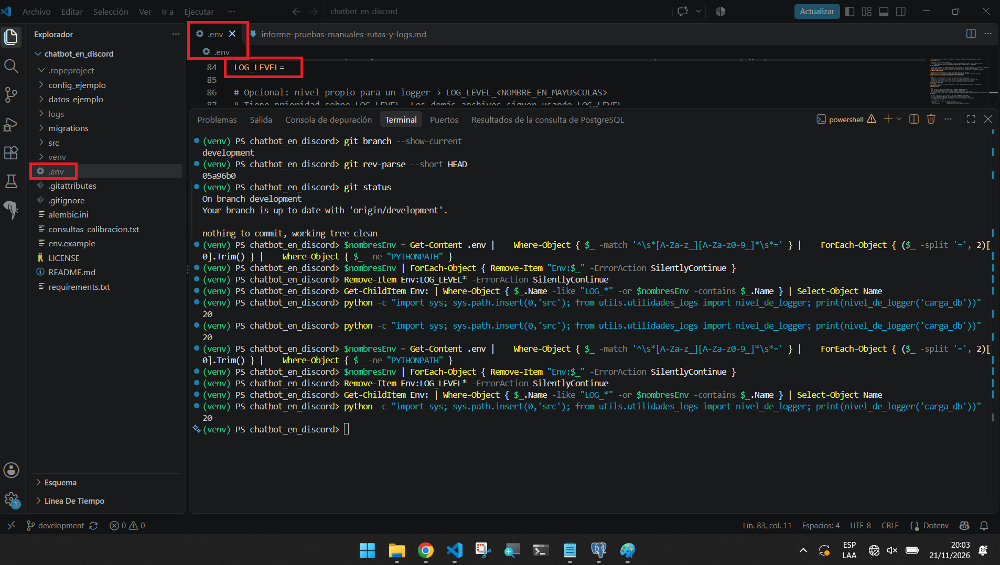

  Captura 3: procedimiento D.

  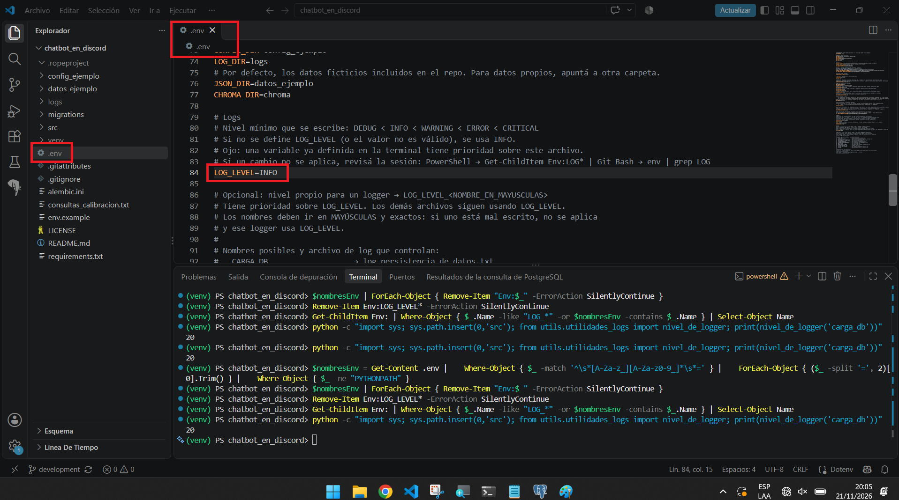

  Notas sobre las capturas:
  - Captura 1 (19:59): se ven el paso 0 (rama `development`, commit `05a96b0`, repositorio limpio), el procedimiento A (la última verificación no muestra ningún nombre), la línea 84 del `.env` con `LOG_LEVEL=PATATA` y el resultado `20`.
  - Captura 2 (20:03): el `.env` guardado con la línea 84 en `LOG_LEVEL=` (nada después del `=`). En la terminal, a continuación del procedimiento A, hay dos resultados `20` seguidos (pasos 1 y 2); después, el procedimiento A repetido (la verificación tampoco muestra ningún nombre) y un tercer `20`.
  - Captura 3 (20:05): el `.env` restaurado con la línea 84 en `LOG_LEVEL=INFO` (procedimiento D). La terminal es la misma de la captura 2, sin comandos nuevos.
  - Los recuadros rojos se agregaron para señalar la pestaña y el archivo `.env`, la línea 84 y el primer resultado. Las capturas no muestran rutas del equipo.
- **Observaciones:**
  - `20` es el nivel `INFO`, que además es el valor por defecto: un valor inválido o vacío debe dar justamente `20`. Como el mismo número saldría si la variable de la sesión estuviera en `INFO` (OBS-01), el procedimiento A se aplicó antes y su verificación no muestra ningún nombre. Como el segundo `20` seguía a otro `20`, se repitió el procedimiento A y se volvió a ejecutar el comando para descartar que viniera de la sesión; esa repetición no figura en los pasos y dio el mismo resultado.
  - Que el programa lee el `.env` está comprobado por otros casos con valores que dan un número distinto (TC-LOG-02, con `LOG_LEVEL=DEBUG`); este caso solo comprueba el valor por defecto ante un valor inválido o vacío.
  - Junto al nombre `powershell` de la terminal aparece el ícono de advertencia (triángulo) en las tres capturas. Es probable que sea el aviso de VS Code de que el `.env` cambió respecto del que cargó la terminal al abrirse (ver OBS-01). No afectó el resultado porque el procedimiento A eliminó las variables de la sesión.
  - No se aplicó el procedimiento E, que este caso no requiere: el comando no usa internet.

### TC-LOG-06: Un aviso real con `LOG_LEVEL=WARNING`

- **Objetivo:** comprobar que un evento de nivel `WARNING` se escribe y que no aparecen `INFO` ni `DEBUG`.
- **Precondiciones:** criterio de entrada general y adicional; procedimiento A aplicado; procedimiento C aplicado antes de la primera ejecución; `LOG_LEVEL=WARNING`; procedimiento E aplicado.
- **Pasos:**
  1. Ejecutar `python src\main_offline.py` **dos veces seguidas, sin borrar la base de datos** entre una y otra.
  2. Tras la segunda ejecución:
     ```powershell
     # Carpeta de la ejecución más reciente (ver procedimiento B).
     $carpeta = Get-ChildItem logs -Directory -Filter "logs_*" | Sort-Object LastWriteTime -Descending | Select-Object -First 1

     # Muestra las líneas con WARNING de cada archivo, indicando el archivo.
     Get-ChildItem $carpeta.FullName -Filter *.txt | Select-String -Pattern "WARNING" -SimpleMatch | Select-Object Filename, Line
     ```
  3. Confirmar la carpeta y contar las líneas `DEBUG` e `INFO` (procedimiento B y su variante para `INFO`, TC-LOG-03 paso 4):
     ```powershell
     # Nombre de la carpeta de la segunda ejecución.
     $carpeta.Name

     # Líneas DEBUG e INFO por archivo (ambas deben dar 0).
     Get-ChildItem $carpeta.FullName -Filter *.txt | ForEach-Object { "{0}: DEBUG={1} INFO={2}" -f $_.Name, @(Select-String -Path $_.FullName -Pattern "DEBUG" -SimpleMatch).Count, @(Select-String -Path $_.FullName -Pattern "INFO" -SimpleMatch).Count }
     ```
  4. Aplicar el procedimiento D.
- **Resultado esperado:** aparece una línea `WARNING` indicando que la base de datos ya contiene preguntas; el procedimiento B da `0` para `DEBUG`.
- **Resultado obtenido:** la primera ejecución creó las tablas (`Running upgrade -> 23f57afc987c, crear_tablas_iniciales`) y la segunda, sin borrar la base, ya no migró (solo `Context impl` y `Will assume transactional DDL` de Alembic). La segunda ejecución generó la carpeta `logs_20_11_26_15_25` con 7 archivos de log. En ellos apareció una única línea `WARNING`, en `log_procesamiento_con_preguntas_cerradas.txt`, del logger `carga_procesador`: «La base de datos ya contiene preguntas. Se cancela la carga para evitar duplicados.» (2026-11-20 15:25:35,134). Ningún otro archivo tuvo líneas `WARNING`, y los 7 archivos tienen `0` líneas `DEBUG` y `0` líneas `INFO`.
- **Estado:** ✅ Pasó
- **Ejecución:** 20/11/2026 · commit `05a96b0` · rama `development`
- **Observaciones:**
  - Las líneas `INFO [alembic...]` de la consola las imprime Alembic según `alembic.ini` y no se escriben en los logs del proyecto (ver TC-INT-01).
  - Este caso completa la limitación de TC-LOG-03: ahora sí se ve una línea de nivel `WARNING` escrita con `LOG_LEVEL=WARNING`.
  - La carpeta tiene 7 archivos y no 9 como en las ejecuciones completas de TC-LOG-01 y TC-LOG-02: faltan `logs_preguntas_para_embeddings.txt` y `log_preguntas_efectivamente_pesistidas_1.txt`. Es coherente con el código (verificado por lectura, no por ejecución): `log_preguntas_efectivamente_pesistidas_N.txt` se nombra dentro de `persistir_preguntas` (`src/database/clase_cargar_bdd.py`), paso que `main_offline.py` omite cuando la base ya tiene preguntas; y `logs_preguntas_para_embeddings.txt` lo crea `obtener_preguntas_y_metadatos`, que `GestorBaseVectorial.crear_si_no_existe` solo llama cuando la base vectorial no existe (en la segunda ejecución `chroma/` ya existía).
- **Evidencia:** carpeta `logs_20_11_26_15_25`:
  ```
  Filename                                      Line
  --------                                      ----
  log_procesamiento_con_preguntas_cerradas.txt  2026-11-20 15:25:35,134 - WARNING - carga_procesador - La base de datos ya contiene preguntas. Se cancela la carga para evitar duplicados.
  ```

  ```
  cargador_yaml.txt: DEBUG=0 INFO=0
  logs_generacion_embeddings.txt: DEBUG=0 INFO=0
  logs_procesar_mensajes.txt: DEBUG=0 INFO=0
  log_json_01.txt: DEBUG=0 INFO=0
  log_migraciones_alembic_automaticas.txt: DEBUG=0 INFO=0
  log_persistencia_de_datos.txt: DEBUG=0 INFO=0
  log_procesamiento_con_preguntas_cerradas.txt: DEBUG=0 INFO=0
  ```

  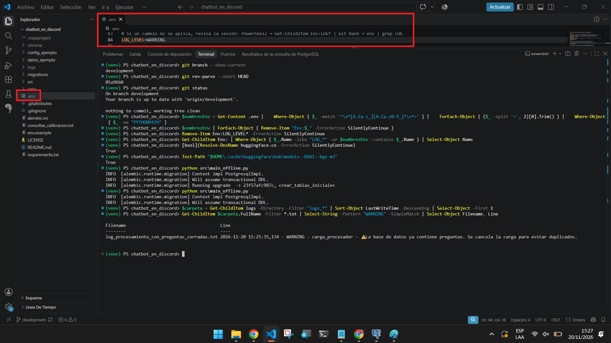

  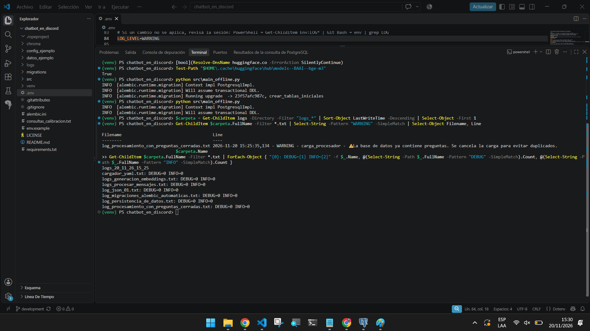

  Notas sobre las capturas:
  - Primera captura: el paso 0 (rama `development`, commit `05a96b0`, repositorio limpio, `$raiz`), el procedimiento A (la última verificación no muestra ningún nombre), el procedimiento E (`True` y `True`), las dos ejecuciones de `main_offline.py` y la búsqueda de `WARNING` (reloj: 15:27 del 20/11/2026).
  - Segunda captura: continuación en la misma terminal (la terminal se desplazó, por eso arriba se ve solo el final del procedimiento E). Muestra la búsqueda de `WARNING`, el nombre de la carpeta y el conteo de `DEBUG` e `INFO` por archivo (reloj: 15:30 del 20/11/2026).
  - Los recuadros rojos de la primera captura se agregaron para señalar el archivo `.env` y la línea `LOG_LEVEL=WARNING` en el editor.

### TC-LOG-07: Nombre de logger mal escrito

- **Objetivo:** comprobar que un nombre incorrecto en `LOG_LEVEL_<LOGGER>` se ignora y el logger usa `LOG_LEVEL`.
- **Precondiciones:** procedimiento A aplicado.
- **Pasos:**
  1. En el `.env`: `LOG_LEVEL=INFO` y `LOG_LEVEL_CARGA_DBB=DEBUG` (con una «B» de más).
  2. Ejecutar el comando de TC-LOG-05.
  3. Aplicar el procedimiento D.
- **Resultado esperado:** imprime `20` (el nombre erróneo no tuvo efecto).
- **Resultado obtenido:** coincide con lo esperado. Con `LOG_LEVEL=INFO` y `LOG_LEVEL_CARGA_DBB=DEBUG` en el `.env`, el comando imprimió `20`: el logger `carga_db` usó `LOG_LEVEL` (`INFO`) y la variable con el nombre mal escrito no tuvo efecto.
- **Estado:** ✅ Pasó
- **Ejecución:** 21/11/2026 · commit `05a96b0` · rama `development`
- **Evidencia:**
  ```
  python -c "import sys; sys.path.insert(0,'src'); from utils.utilidades_logs import nivel_de_logger; print(nivel_de_logger('carga_db'))"
  20
  ```

  Captura 1: ejecución (paso 1 y 2).

  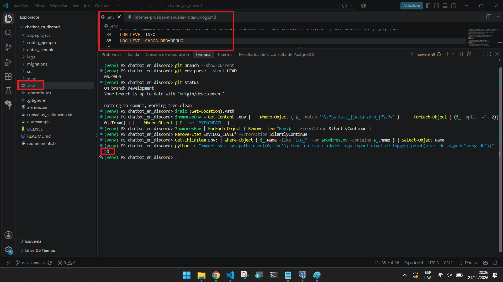

  Captura 2: procedimiento D.

  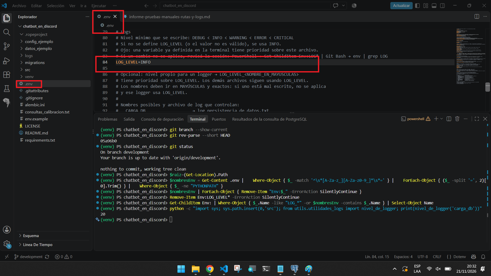

  Notas sobre las capturas:
  - Captura 1 (20:26): se ven el paso 0 (rama `development`, commit `05a96b0`, repositorio limpio), el procedimiento A (la última verificación no muestra ningún nombre), el `.env` guardado con la línea 84 `LOG_LEVEL=INFO` y la línea 85 `LOG_LEVEL_CARGA_DBB=DEBUG`, y el resultado `20`.
  - Captura 2 (20:32): el `.env` restaurado: la línea 84 en `LOG_LEVEL=INFO` y la línea 85, que contenía la variable mal escrita, vacía (procedimiento D). La terminal es la misma de la captura 1, sin comandos nuevos.
  - Los recuadros rojos se agregaron para señalar la pestaña y el archivo `.env`, las líneas 84 y 85 y el resultado. Las capturas no muestran rutas del equipo.
- **Observaciones:**
  - El comando imprime un solo número: el nivel del logger `carga_db` (`DEBUG` = 10, `INFO` = 20). Si el nombre mal escrito hubiera tenido efecto, habría impreso `10`. El caso es la contracara de TC-LOG-04: con el nombre bien escrito (`LOG_LEVEL_CARGA_DB=DEBUG`) ese logger escribe líneas `DEBUG`; con la «B» de más, no.
  - Como `20` también saldría si la sesión tuviera `LOG_LEVEL=INFO` o si el programa no leyera el `.env`, se aplicó el procedimiento A (su verificación no muestra ningún nombre); que el programa lee el `.env` está comprobado en TC-LOG-02 y TC-LOG-04.
  - Junto al nombre `powershell` de la terminal aparece el ícono de advertencia (triángulo) en las dos capturas; es probable que sea el aviso de VS Code por los cambios del `.env` (ver OBS-01). No afectó el resultado porque el procedimiento A eliminó las variables de la sesión.
  - No se aplicó el procedimiento E, que este caso no requiere: el comando no usa internet.

### TC-LOG-08: Prioridad del nivel por logger

- **Objetivo:** comprobar que `LOG_LEVEL_<LOGGER>` gana sobre `LOG_LEVEL` también cuando es **más restrictivo**.
- **Precondiciones:** procedimiento A aplicado.
- **Pasos:**
  1. En el `.env`: `LOG_LEVEL=DEBUG` y `LOG_LEVEL_CARGA_DB=WARNING`.
  2. Ejecutar:
     ```powershell
     # Imprime los niveles de dos loggers distintos: carga_db y carga_procesador.
     python -c "import sys; sys.path.insert(0,'src'); from utils.utilidades_logs import nivel_de_logger; print(nivel_de_logger('carga_db'), nivel_de_logger('carga_procesador'))"
     ```
  3. Aplicar el procedimiento D.
- **Resultado esperado:** imprime `30 10` (`carga_db` en WARNING, `carga_procesador` en DEBUG).
- **Resultado obtenido:** coincide con lo esperado. El comando imprimió `30 10`: `carga_db` quedó en `WARNING` (30), el nivel propio, aunque `LOG_LEVEL=DEBUG` es menos restrictivo; `carga_procesador`, que no tiene nivel propio, quedó en `DEBUG` (10), el nivel general.
- **Estado:** ✅ Pasó
- **Ejecución:** 21/11/2026 · commit `05a96b0` · rama `development`
- **Evidencia:**
  ```
  python -c "import sys; sys.path.insert(0,'src'); from utils.utilidades_logs import nivel_de_logger; print(nivel_de_logger('carga_db'), nivel_de_logger('carga_procesador'))"
  30 10
  ```

  Captura 1: ejecución (pasos 1 y 2).

  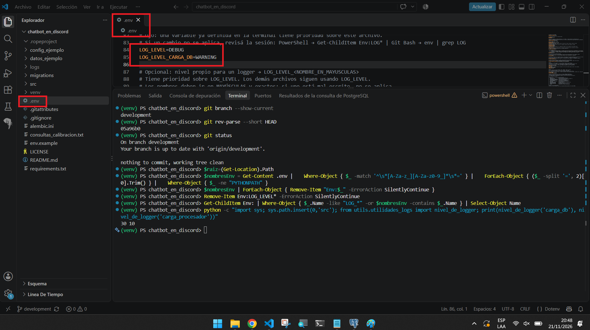

  Captura 2: procedimiento D.

  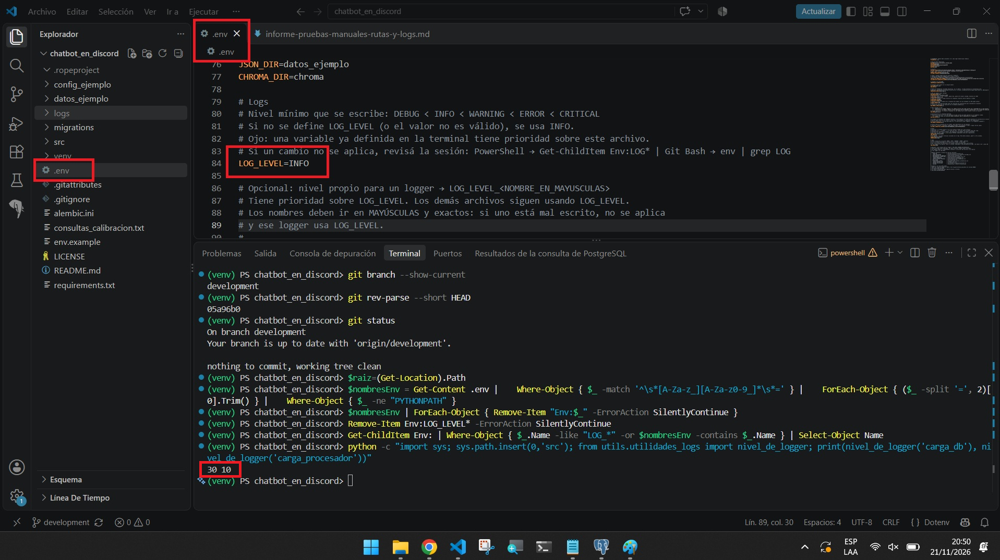

  Notas sobre las capturas:
  - Captura 1 (20:48): se ven el paso 0 (rama `development`, commit `05a96b0`, repositorio limpio), el procedimiento A (la última verificación no muestra ningún nombre), el `.env` guardado con la línea 84 `LOG_LEVEL=DEBUG` y la línea 85 `LOG_LEVEL_CARGA_DB=WARNING`, y el resultado `30 10`.
  - Captura 2 (20:50): el `.env` restaurado: la línea 84 en `LOG_LEVEL=INFO` y la línea 85, que contenía el nivel propio, vacía (procedimiento D). La terminal es la misma de la captura 1, sin comandos nuevos.
  - Los recuadros rojos se agregaron para señalar la pestaña y el archivo `.env` y las líneas modificadas o restauradas; en la captura 2 también señalan el resultado `30 10`, que sigue visible en la terminal. Las capturas no muestran rutas del equipo.
- **Observaciones:**
  - El comando imprime dos números, en el orden en que se pidieron: primero `carga_db` y después `carga_procesador` (`DEBUG` = 10, `WARNING` = 30). Una sola ejecución comprueba dos cosas: que el nivel propio de `carga_db` gana sobre el general y que un logger sin nivel propio usa el general.
  - Complementa TC-LOG-04, donde el nivel propio (`DEBUG`) era menos restrictivo que el general (`INFO`); acá es al revés (`WARNING` sobre `DEBUG`), de modo que la prioridad no depende de cuál de los dos niveles es más restrictivo.
  - `30` no puede venir de la sesión: el procedimiento A se aplicó antes y su verificación no muestra ningún nombre.
  - Junto al nombre `powershell` de la terminal aparece el ícono de advertencia (triángulo) en las dos capturas; es probable que sea el aviso de VS Code por los cambios del `.env` (ver OBS-01). No afectó el resultado porque el procedimiento A eliminó las variables de la sesión.
  - No se aplicó el procedimiento E, que este caso no requiere: el comando no usa internet.

---

## 8. Caso de prueba: configuración

### TC-CFG-01: Nombre del modelo de embeddings (valor por defecto)

- **Objetivo:** comprobar que el nombre del modelo se lee del `.env` y que, si la variable está vacía, se usa el nombre por defecto definido en el código.
- **Precondiciones:** criterio de entrada general; procedimiento A aplicado.
- **Pasos:**
  1. Con `EMBEDDINGS_MODELO=BAAI/bge-m3` en el `.env`, ejecutar el comando de abajo y anotar el resultado.
  2. Dejar `EMBEDDINGS_MODELO=` (vacío) y ejecutarlo de nuevo.
  3. Aplicar el procedimiento D.
  ```powershell
  # Imprime el nombre del modelo de embeddings que se usaría.
  python -c "import sys; sys.path.insert(0,'src'); from embeddings.modelo_embeddings import nombre_modelo_embeddings; print(nombre_modelo_embeddings())"
  ```
- **Resultado esperado:** el paso 1 imprime `BAAI/bge-m3`; el paso 2 imprime el valor de `MODELO_EMBEDDINGS_POR_DEFECTO` definido en `src/embeddings/modelo_embeddings.py` (en el commit probado: `paraphrase-multilingual-MiniLM-L12-v2`).
- **Resultado obtenido:** coincide con lo esperado. Con `EMBEDDINGS_MODELO=BAAI/bge-m3` el comando imprimió `BAAI/bge-m3`; con `EMBEDDINGS_MODELO=` (vacío) imprimió `paraphrase-multilingual-MiniLM-L12-v2`, el valor por defecto. Con la variable vacía el programa no falló ni usó un texto vacío como nombre del modelo.
- **Estado:** ✅ Pasó
- **Ejecución:** 21/11/2026 · commit `05a96b0` · rama `development`
- **Evidencia:**
  ```
  Paso 1, con EMBEDDINGS_MODELO=BAAI/bge-m3 en el .env:
  python -c "import sys; sys.path.insert(0,'src'); from embeddings.modelo_embeddings import nombre_modelo_embeddings; print(nombre_modelo_embeddings())"
  BAAI/bge-m3

  Paso 2, con EMBEDDINGS_MODELO= (vacío) en el .env (mismo comando):
  paraphrase-multilingual-MiniLM-L12-v2

  Después del procedimiento D, con EMBEDDINGS_MODELO=BAAI/bge-m3 (mismo comando; comprobación extra):
  BAAI/bge-m3
  ```

  Captura 1: preparación y paso 1.

  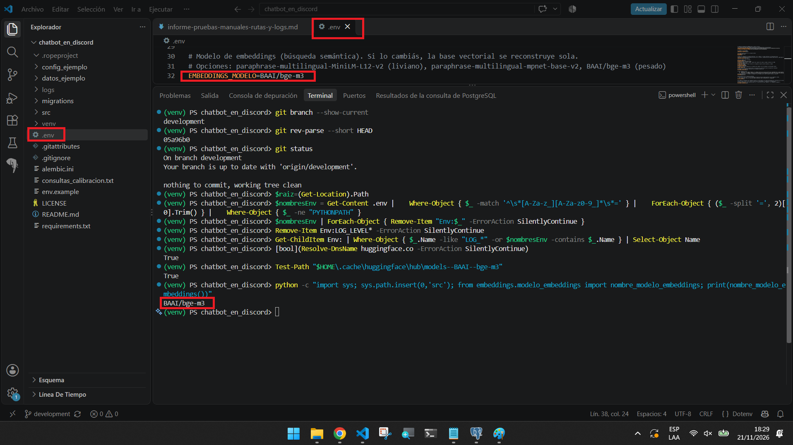

  Captura 2: paso 2.

  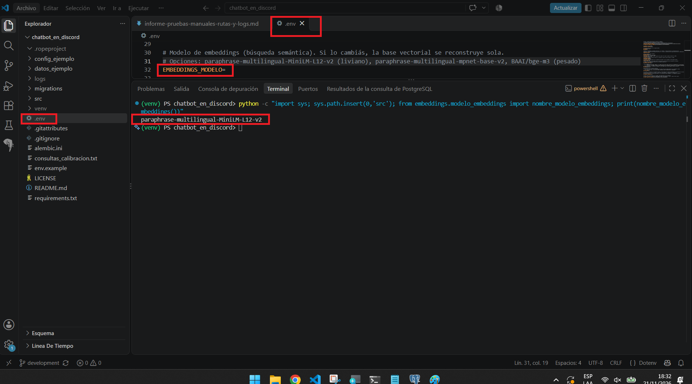

  Captura 3: procedimiento D y comprobación.

  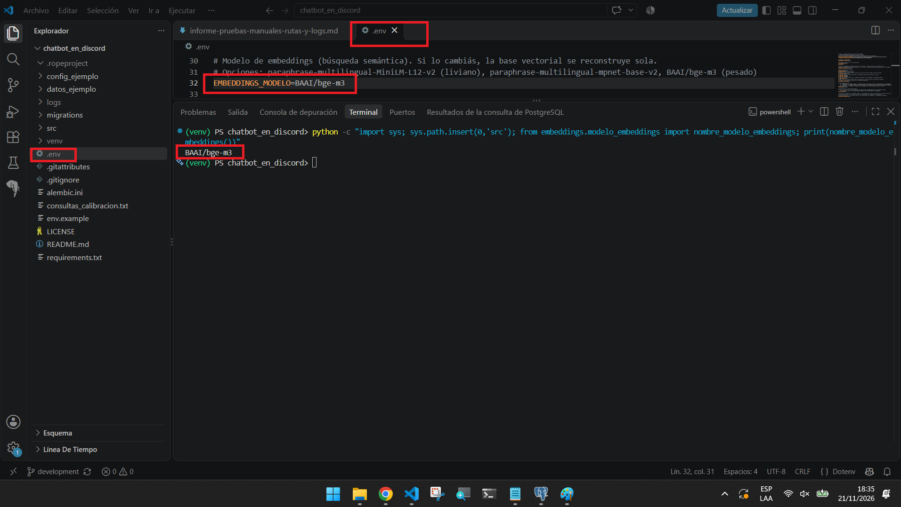

  Notas sobre las capturas:
  - Captura 1 (18:29): se ven el paso 0 (rama `development`, commit `05a96b0`, repositorio limpio, `$raiz`), el procedimiento A (la última verificación no muestra ningún nombre), el procedimiento E (ambos `True`) y la ejecución del comando con su resultado. En el editor, el `.env` abierto con la línea 32 `EMBEDDINGS_MODELO=BAAI/bge-m3`.
  - Captura 2 (18:32): el `.env` guardado con la línea 32 en `EMBEDDINGS_MODELO=` (nada después del `=`) y el resultado del mismo comando.
  - Captura 3 (18:35): el `.env` restaurado (línea 32 en `EMBEDDINGS_MODELO=BAAI/bge-m3`) y el comando ejecutado de nuevo, que imprime otra vez `BAAI/bge-m3`.
  - Los recuadros rojos se agregaron para señalar la pestaña y el archivo `.env`, la línea 32 y el resultado de cada ejecución. Las capturas no muestran rutas del equipo.
- **Observaciones:**
  - Además del procedimiento A se aplicó el procedimiento E, que este caso no requiere: el comando solo imprime el nombre del modelo, no lo carga ni usa internet.
  - Junto al nombre `powershell` de la terminal, la captura 2 muestra un ícono de advertencia (triángulo) que no aparece en las capturas 1 y 3. Es probable que sea el aviso de VS Code de que el `.env` cambió respecto del que cargó la terminal al abrirse (ver OBS-01); no se comprobó la causa. No afectó el resultado porque el procedimiento A había eliminado antes las variables de la sesión.
  - El caso verifica el nombre que se calcula, no que el modelo se cargue: la carga con `BAAI/bge-m3` se comprueba en las ejecuciones completas (TC-INT-01 y TC-LOG-01 a TC-LOG-04).

---

## 9. Casos de prueba: integración

### TC-INT-01: Ejecución completa sobre una base vacía

- **Objetivo:** comprobar que el flujo completo funciona con las rutas y logs centralizados.
- **Precondiciones:** base de datos de prueba vacía; carpeta `chroma/` eliminada; datos de `datos_ejemplo/`; procedimiento E aplicado; procedimiento A aplicado.
- **Pasos:** `python src\main_offline.py`
- **Resultado esperado:** se crean las tablas con las migraciones, se procesan los JSON, se genera una carpeta nueva en `logs/` con los archivos de log y no aparecen errores en consola.
- **Resultado obtenido:** coincide con lo esperado. Esta ejecución es la misma que se usó como evidencia de TC-LOG-01: las migraciones crearon las tablas, el programa terminó sin errores en consola y se generó una carpeta nueva en `logs/` con 9 archivos.
- **Estado:** ✅ Pasó
- **Ejecución:** 20/11/2026 · commit `05a96b0` · rama `development`
- **Evidencia:**
  ```
  INFO  [alembic.runtime.migration] Context impl PostgresqlImpl.
  INFO  [alembic.runtime.migration] Will assume transactional DDL.
  INFO  [alembic.runtime.migration] Running upgrade  -> 23f57afc987c, crear_tablas_iniciales
  ```
  Carpeta de logs generada: `logs_20_11_26_12_52`, con 9 archivos (listados en TC-LOG-01; captura en `evidencias/tc-log-01-conteo-debug.png`).
- **Observaciones:** las tres líneas `INFO [alembic...]` las imprime Alembic según `alembic.ini`; no provienen de los logs del proyecto.

### TC-INT-02: Ejecución sin archivos JSON

- **Objetivo:** comprobar que, sin datos, el programa avisa con un error claro y se detiene de forma controlada.
- **Precondiciones:** criterio de entrada general; `LOG_LEVEL=INFO`; procedimiento A aplicado.
- **Pasos:**
  1. Crear una carpeta vacía y apuntar el `.env` a ella: `JSON_DIR=carpeta_sin_json`.
  2. Ejecutar:
     ```powershell
     # Crea una carpeta vacía en la raíz del proyecto.
     New-Item -ItemType Directory carpeta_sin_json

     # Ejecuta la carga offline sin datos.
     python src\main_offline.py

     # Muestra con qué código terminó (0 = bien, otro número = error).
     $LASTEXITCODE

     # Busca las líneas ERROR en los logs de la ejecución (carpeta logs_* más reciente). Las dos instrucciones se separan con «;» y van en líneas contiguas para que el comando funcione aunque al copiarlo se pierda un salto de línea (ver las observaciones del caso).
     $carpeta = Get-ChildItem logs -Directory -Filter "logs_*" | Sort-Object LastWriteTime -Descending | Select-Object -First 1;
     if ($carpeta) { Get-ChildItem $carpeta.FullName -Filter *.txt | Select-String -Pattern "ERROR" -SimpleMatch | Select-Object Filename, Line } else { Write-Host "No se encontró ninguna carpeta logs_*" }

     # Limpieza: borra la carpeta vacía.
     Remove-Item carpeta_sin_json
     ```
  3. Aplicar el procedimiento D.
- **Resultado esperado:** el programa informa que no encontró archivos JSON y termina sin procesar datos (código de salida distinto de `0`); el mensaje figura en el log con nivel `ERROR`, visible aunque el nivel sea `INFO`.
- **Resultado obtenido:** coincide con lo esperado. Con `JSON_DIR=carpeta_sin_json` (carpeta vacía) y `LOG_LEVEL=INFO`, `main_offline.py` terminó con código de salida `1` (distinto de `0`) y sin mostrar ningún texto en la consola. En el log `log_procesamiento_con_preguntas_cerradas.txt` quedó una línea de nivel `ERROR`, del logger `carga_procesador`, que informa que no se encontraron archivos JSON para procesar y que finaliza la ejecución; fue la única línea `ERROR` de la carpeta de logs más reciente. La línea aparece cortada en la captura (`Finalizando eje...`) por el ancho de la terminal.
- **Estado:** ✅ Pasó
- **Ejecución:** 21/11/2026 · commit `05a96b0` · rama `development`
- **Evidencia:**
  ```
  New-Item -ItemType Directory carpeta_sin_json

      Directorio: <RUTA_DEL_PROYECTO>

  Mode                 LastWriteTime         Length Name
  ----                 -------------         ------ ----
  d-----        21/11/2026     17:24                carpeta_sin_json

  Test-Path carpeta_sin_json
  True

  python src\main_offline.py
  (sin salida en la consola)

  $LASTEXITCODE
  1

  Filename                                     Line
  --------                                     ----
  log_procesamiento_con_preguntas_cerradas.txt 2026-11-21 17:26:14,238 - ERROR - carga_procesador - ❌ No se encontraron archivos JSON para procesar. Finalizando eje...

  Remove-Item carpeta_sin_json
  Test-Path carpeta_sin_json
  False
  ```

  Captura 1: preparación (`.env` y procedimientos A y E).

  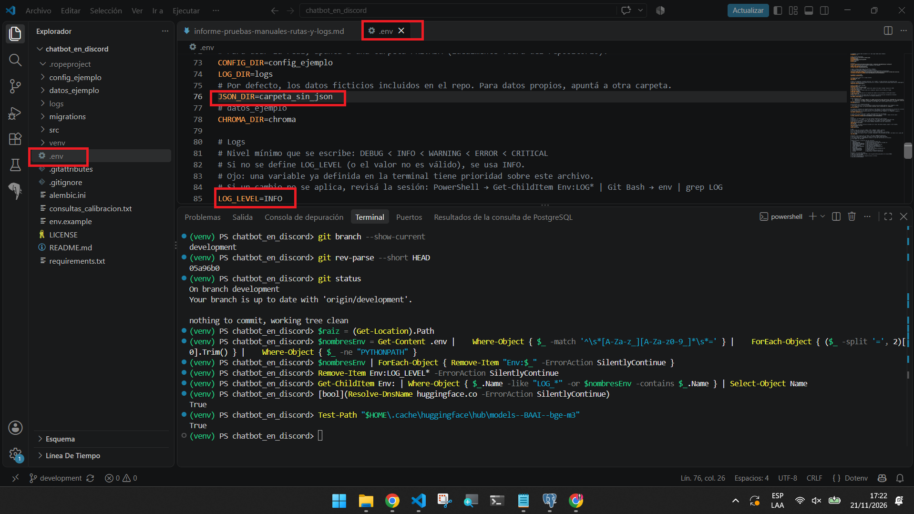

  Captura 2: ejecución.

  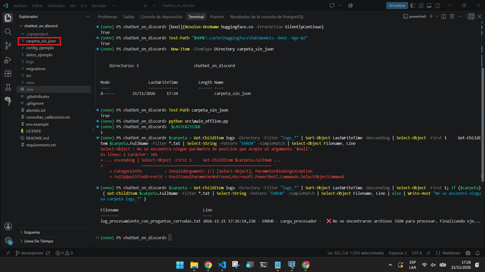

  Captura 3: limpieza y restauración del `.env` (pasos 2 y 3).

  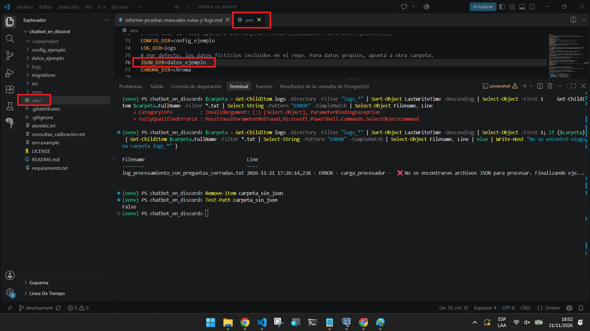

  Notas sobre las capturas:
  - Captura 1 (17:22): se ven el `.env` abierto en el editor, con la línea 76 `JSON_DIR=carpeta_sin_json` y la línea 85 `LOG_LEVEL=INFO`; el paso 0 (rama `development`, commit `05a96b0`, repositorio limpio, `$raiz`); el procedimiento A (la última verificación no muestra ningún nombre) y el procedimiento E (ambos resultados `True`). Los recuadros rojos se agregaron para señalar la pestaña y el archivo `.env` y las dos líneas modificadas.
  - Captura 2 (17:28): continúa la terminal de la captura 1 (arriba se repiten los dos resultados de E). Se ven la creación de `carpeta_sin_json` (recuadro rojo en el Explorador), `Test-Path` en `True`, la ejecución de `main_offline.py`, `$LASTEXITCODE` en `1` y la línea `ERROR` del log. La barra negra cubre la ruta de `Directorio:` (queda visible solo la letra de la unidad).
  - Captura 3 (18:02): se ven `Remove-Item carpeta_sin_json` y `Test-Path carpeta_sin_json` en `False` (la carpeta ya no figura en el Explorador; el `Test-Path` es una comprobación extra, no figura en los pasos) y el `.env` guardado con la línea 76 en `JSON_DIR=datos_ejemplo` (procedimiento D). `LOG_LEVEL` no se modificó en este caso, por lo que no hace falta restaurarlo. Arriba se ve el primer intento fallido de la búsqueda (ver observaciones). Los recuadros rojos señalan la pestaña y el archivo `.env` y la línea restaurada. La captura no muestra rutas del equipo.
  - La hora de la línea `ERROR` (17:26:14) cae entre la creación de la carpeta (17:24) y el reloj de la captura (17:28): corresponde a esta ejecución y no a una anterior.
- **Observaciones:**
  - Además del procedimiento A se aplicaron, por precaución, los procedimientos E y C. No son necesarios para este caso (ver el procedimiento C): el programa se detiene al no encontrar JSON, antes de tocar la base. Consistente con eso, la consola no mostró las líneas de Alembic que sí aparecen cuando se ejecutan las migraciones (TC-INT-01). En el Explorador de las capturas no figura la carpeta `chroma/`.
  - El primer intento de buscar las líneas `ERROR` falló con `Select-Object : No se encuentra ningún parámetro de posición que acepte el argumento '$null'`. Se debió al copiado del comando: se perdió el salto de línea entre `Select-Object -First 1` y `Get-ChildItem`, así que ambas instrucciones quedaron en una sola línea y `$carpeta` todavía no tenía valor. No está relacionado con el programa. Se repitió con las instrucciones separadas por `;` y con la comprobación `if ($carpeta)`, que es la versión que figura en los pasos (el campo «Evidencia» muestra la salida de ese segundo intento).
  - El aviso de error queda solo en el archivo de log: la consola no muestra nada y quien ejecuta el programa solo ve que termina sin procesar datos (ver OBS-04).
  - Cierre del caso: a las 18:02 se borró `carpeta_sin_json` y se restauró `JSON_DIR=datos_ejemplo` en el `.env` (captura 3); el entorno quedó en el estado base para el caso siguiente.

---

## 10. Casos opcionales pendientes

Todos los casos de la ronda están ejecutados (secciones 6 a 9). Quedan estos dos casos opcionales, que no son necesarios para dar por completa la ronda. Al ejecutar cada uno: detallar sus pasos, completar «Resultado obtenido» y «Evidencia», cambiar el estado a ✅ o ❌ (si falla, registrar un hallazgo en la sección 12) y actualizar el resumen de la sección 11. Al terminar cada caso, aplicar el procedimiento D.

| ID | Objetivo | Resultado esperado | Motivo |
|---|---|---|---|
| TC-BOT-01 | Arranque del bot con `LOG_LEVEL_DISCORD=WARNING` | `log_discord_*` registra solo avisos y errores | Requiere token y servidor de Discord |
| TC-INT-03 | Instalación limpia siguiendo el README (clon nuevo, `env.example` → `.env`, `main_offline.py`) | Un tercero puede ejecutar el proyecto con los datos de ejemplo | Requiere un entorno nuevo e instalar dependencias |

## 11. Resumen de resultados

| Estado | Cantidad |
|---|---|
| ✅ Pasó | 17 |
| ❌ Falló | 0 |
| ⏳ Por ejecutar | 2 (opcionales, fuera de esta ronda) |
| **Total de casos** | **19** (17 de la ronda y 2 opcionales) |

**Nota sobre los casos ya ejecutados.** TC-RUT-02 se ejecutó antes de incorporar a sus precondiciones los procedimientos A (completo) y E; TC-LOG-01, TC-LOG-02, TC-LOG-03, TC-LOG-04 y TC-INT-01 se repitieron el 20/11/2026 con ambos aplicados, TC-LOG-06 se ejecutó ese día con ambos aplicados, TC-RUT-03 con el procedimiento A, TC-LOG-05 (21/11/2026) con A (repetido una vez) sin E, TC-LOG-07 y TC-LOG-08 (21/11/2026) con A sin E, y TC-CFG-01 y TC-INT-02 (21/11/2026) con A y E (TC-INT-02, además, con C). Sus resultados coincidieron con lo esperado, lo que indica que ninguna variable de sesión ni la falta de conexión alteró esos casos. La única diferencia entre la sesión y el `.env` que se detectó fue `LOG_LEVEL` (OBS-01), que se resolvió en su momento.

**Estado de la ronda.** Los 17 casos de la ronda se ejecutaron y pasaron; no hubo casos fallidos. Los hallazgos quedaron documentados y ninguno requiere repetir casos. OBS-03 (sin internet) se ejecutó y se completó: sin conexión el programa falla tras unos 3 minutos de reintentos; los avisos de `huggingface_hub` no llegan a los archivos de log; y con `HF_HUB_OFFLINE=1` el programa termina bien. Las acciones sugeridas en OBS-02, OBS-03 y OBS-04 son cambios aparte (tabla de abajo), que se hacen después de entregar este informe para no modificar la versión probada (`05a96b0`); la de OBS-02 ya se resolvió (commit `269318d`). Los dos casos opcionales de la sección 10 quedan fuera de la ronda.

**Acciones pendientes, fuera de esta ronda** (ninguna cambia el resultado de los 17 casos):

| Origen | Acción | Después de hacerla |
|---|---|---|
| OBS-02 | En `.gitignore`, reemplazar `.env` y `.env.*` por `.env*` | `git check-ignore -v .envi` debe mostrar la regla. ✅ Resuelta en commit `269318d` (22/11/2026) |
| OBS-04 | En `main_offline.py`, reemplazar `sys.exit(1)` por `sys.exit("mensaje")` (sin emojis), o agregar un handler de consola para `ERROR` | Repetir TC-INT-02 en el commit nuevo: el mensaje debe verse en la consola y el código de salida seguir en `1` |
| OBS-03 | Documentar `HF_HUB_OFFLINE=1` en el README | — |
| OBS-03 | Evaluar que el programa avise o falle rápido sin conexión, en lugar de reintentar unos 3 minutos | Repetir la ejecución sin conexión |

Al resolver cada una, anotar en la observación correspondiente «resuelta en commit `<hash>`».

## 12. Observaciones y hallazgos

**OBS-01: una variable de entorno de la sesión tiene prioridad sobre el `.env`.**
Al probar `LOG_LEVEL=DEBUG` en el `.env`, no aparecían líneas `DEBUG`. La causa fue una variable `LOG_LEVEL=INFO` ya definida en la sesión de PowerShell (`$env:LOG_LEVEL`). `python-dotenv` no sobrescribe variables existentes por defecto, de modo que el valor de la sesión prevaleció.

**Origen de la variable de sesión:** la terminal integrada de VS Code carga el `.env` completo al abrirse (`python.terminal.useEnvFile = true`). Lo más probable es que `LOG_LEVEL=INFO` viniera del `.env` en el momento de abrir la terminal y que el cambio posterior a `DEBUG` no la actualizara. Se comprobó que `LOG_LEVEL`, `LOG_DIR`, `JSON_DIR`, `CONFIG_DIR` y `EMBEDDINGS_MODELO` no están definidas a nivel de Windows.

- **Clasificación:** comportamiento esperado de `load_dotenv()`, no un defecto del código.
- **Acción:** se agregó el procedimiento A a este informe. Al eliminar la variable de sesión, TC-LOG-02 se comportó como se esperaba.

**OBS-02: `.envi` aparece como archivo sin seguimiento en Git (no ignorado).**
Al renombrar `.env` a `.envi` en TC-RUT-02, VS Code lo muestra con la letra `U` (sin seguimiento) y la rama con asterisco, en lugar de en gris como los archivos ignorados (`venv`, `logs`). Todo indica que `.gitignore` cubre `.env` pero no esa variante. Riesgo: un `git add .` mientras el archivo está renombrado lo incluiría, con los datos de conexión.

- **Análisis:** el `.gitignore` del commit probado contiene `.env` y `.env.*`. El patrón `.env.*` exige un punto después de `env`, por lo que cubre `.env.bak` pero no `.envi`. Coincide con la letra `U` de la captura.
- **Clasificación:** probable defecto menor de configuración (no del código). Para confirmarlo en tu equipo: `git check-ignore -v .envi` (sin salida = no está ignorado).
- **Acción:** no hacer commits mientras el archivo esté renombrado. Propuesta, en un cambio aparte y fuera de esta ronda: reemplazar las reglas `.env` y `.env.*` por una sola, `.env*`, que cubre ambas y también `.envi`. No afecta a `env.example`, porque ese nombre no empieza con punto (si algún día existiera un `.env.example` con punto, habría que agregar `!.env.example`). Se verifica con `git check-ignore -v .envi`.
- **Resolución:** resuelta en commit `269318d` (22/11/2026, rama `development`): en `.gitignore` se reemplazaron las reglas `.env` y `.env.*` por `.env*` (1 línea agregada, 2 eliminadas). Verificación hecha con el cambio ya guardado, antes del commit: `.envi` y `.env` quedan ignorados por la regla de la línea 2. No se repitió el renombrado del `.env` de TC-RUT-02.
  ```
  PS> git check-ignore -v .envi
  .gitignore:2:.env*      .envi
  PS> git check-ignore -v .env
  .gitignore:2:.env*      .env
  PS> git diff
  -.env
  -.env.*
  +.env*
  PS> git commit -m "fix: ignorar todas las variantes de .env en .gitignore"
  [development 269318d] fix: ignorar todas las variantes de .env en .gitignore
   1 file changed, 1 insertion(+), 2 deletions(-)
  ```

**OBS-03: sin internet, `main_offline.py` reintenta unos 3 minutos y termina con error al cargar el modelo de embeddings, aunque el modelo esté en la caché.**
En una primera ejecución sin conexión (descartada: se interrumpió con Ctrl+C) se vio que, después de las migraciones, el programa intentaba consultar `huggingface.co` y reintentaba. Se repitió la ejecución completa, sin interrumpir, para saber cómo termina.

- **Ejecución:** 21/11/2026 (22:35 a 22:39) · commit `05a96b0` · rama `development`.
- **Condiciones:** procedimiento A aplicado; procedimiento E: `False` (sin resolución de `huggingface.co`) y `True` (modelo en la caché); sin `HF_HUB_OFFLINE`. La línea `Running upgrade -> 23f57afc987c` indica que la base estaba vacía al empezar. En la terminal aparece un `^C` suelto antes del `Test-Path`: se escribió en el prompt vacío, sin ningún programa en ejecución, y no tiene efecto.
- **Resultado:**
  1. Después de las migraciones, el programa intentó consultar `huggingface.co` por 8 archivos del modelo (`modules.json` dos veces, `config_sentence_transformers.json`, `README.md`, `sentence_bert_config.json`, `adapter_config.json`, `config.json` y `tokenizer_config.json`). Cada consulta falló con `NameResolutionError` y se reintentó 5 veces, con esperas de 1, 2, 4, 8 y 8 segundos: 23 segundos por archivo, unos 3 minutos solo de esperas.
  2. Al agotar los reintentos **no siguió con la caché local**: terminó con un traceback y `requests.exceptions.ConnectionError`, en `crear_modelo_embeddings()` (`main_offline.py`, línea 84; `modelo_embeddings.py`, línea 23). Según el traceback, el error sale de `transformers` (`_patch_mistral_regex` → `is_base_mistral` → `model_info`), que consulta la API `/api/models/BAAI/bge-m3` y no tiene alternativa local.
  3. Cada mensaje de `huggingface_hub` aparece dos veces en la consola. El segundo (`WARNI [huggingface_hub.utils._http]`) no tiene el formato de los loggers del proyecto (`%(asctime)s - %(levelname)s - %(name)s`), sino el de `alembic.ini` (`%(levelname)-5.5s [%(name)s]`). La explicación más probable es que `migrations/env.py` (línea 34) llama a `fileConfig(..., disable_existing_loggers=False)`, que instala ese handler de consola en el logger raíz y hace que los avisos de `huggingface_hub` se impriman dos veces. La existencia de esa llamada se verificó en el código (22/11/2026); que sea la causa de la duplicación sigue siendo una hipótesis: no se comprobó.
  4. Por el punto donde falló (antes de crear la base vectorial), la carga a PostgreSQL ya se había hecho: la ejecución dejó la base con datos y sin `chroma/`.

- **Clasificación:** hallazgo confirmado. Es una limitación de robustez y de usabilidad: el arranque depende de internet aunque el modelo ya esté descargado, y el fallo llega recién después de unos 3 minutos. No es un defecto de la centralización de rutas ni de los niveles de log, que son lo que se probó en esta ronda. Que el modelo estaba completo en la caché no está demostrado (`Test-Path` solo comprueba la carpeta), pero ya se había cargado antes, con internet, en TC-INT-01 y TC-LOG-01 a TC-LOG-04.
- **Efecto en la ronda:** ningún caso ejecutado se vio afectado: los que cargan el modelo se hicieron con internet (procedimiento E) y el resto no lo usa. Se mantiene la exigencia del procedimiento E.
- **Comprobaciones posteriores (21/11/2026):**
  1. **Los avisos de `huggingface_hub` no llegan a los archivos de log.** En la carpeta de la ejecución sin conexión (`logs_21_11_26_22_35`, confirmada por el nombre) la búsqueda de la palabra `huggingface` no devolvió ninguna línea (captura de las 23:01). Es lo esperable por `propagate = False` y por el handler de consola de Alembic: los avisos duplicados son solo de consola. La captura no muestra cuántos archivos tenía la carpeta; la ejecución había llegado a la persistencia, así que había logs.
  2. **El modo sin conexión funciona.** Con internet desconectado, procedimiento A, procedimiento E (`False` y `True`), procedimiento C aplicado (el Explorador no tenía `chroma/` y Alembic volvió a crear las tablas), `.env` base y `$env:HF_HUB_OFFLINE = "1"`, `python src\main_offline.py` terminó sin reintentos y sin traceback: la consola mostró solo las tres líneas de Alembic y apareció la carpeta `chroma/` (la base vectorial se crea después de cargar el modelo). La ejecución tardó menos de 2 minutos: es lo que separa la captura previa (23:06) de la posterior (23:08), con el tipeo incluido; no se cronometró. Después se eliminó la variable (`Remove-Item Env:HF_HUB_OFFLINE`) y `Test-Path Env:HF_HUB_OFFLINE` dio `False`. Limitaciones: no se registró `$LASTEXITCODE` y no se revisaron los archivos de log de esa ejecución.
- **Acción sugerida (cambio aparte, fuera de esta ronda):** documentar `HF_HUB_OFFLINE=1` en el README (ya verificado) y evaluar que el programa avise o falle rápido cuando no hay conexión, en lugar de reintentar unos 3 minutos.
- **Evidencia** (resumida: se omiten las repeticiones y se reemplaza la ruta del proyecto por `<RUTA_DEL_PROYECTO>`):
  ```
  PS> [bool](Resolve-DnsName huggingface.co -ErrorAction SilentlyContinue)
  False
  PS> Test-Path "$HOME\.cache\huggingface\hub\models--BAAI--bge-m3"
  True
  PS> python src\main_offline.py
  INFO  [alembic.runtime.migration] Context impl PostgresqlImpl.
  INFO  [alembic.runtime.migration] Will assume transactional DDL.
  INFO  [alembic.runtime.migration] Running upgrade  -> 23f57afc987c, crear_tablas_iniciales
  '(MaxRetryError(... Failed to resolve 'huggingface.co' ...)' thrown while requesting HEAD https://huggingface.co/BAAI/bge-m3/resolve/main/modules.json
  WARNI [huggingface_hub.utils._http] '(MaxRetryError(... Failed to resolve 'huggingface.co' ...)' thrown while requesting HEAD https://huggingface.co/BAAI/bge-m3/resolve/main/modules.json
  Retrying in 1s [Retry 1/5].
  WARNI [huggingface_hub.utils._http] Retrying in 1s [Retry 1/5].
  ... (se repite con 2 s, 4 s, 8 s y 8 s, y luego con cada uno de los otros archivos)
  Traceback (most recent call last):
    ...
    File "<RUTA_DEL_PROYECTO>\src\main_offline.py", line 84, in main
      modelo = crear_modelo_embeddings()
    File "<RUTA_DEL_PROYECTO>\src\embeddings\modelo_embeddings.py", line 23, in crear_modelo_embeddings
      return HuggingFaceEmbeddings(
    ...
    File ".../transformers/tokenization_utils_base.py", line 2432, in is_base_mistral
      model = model_info(model_id)
    ...
  requests.exceptions.ConnectionError: (MaxRetryError(... Failed to resolve 'huggingface.co' ... url: /api/models/BAAI/bge-m3 ...)
  ```

  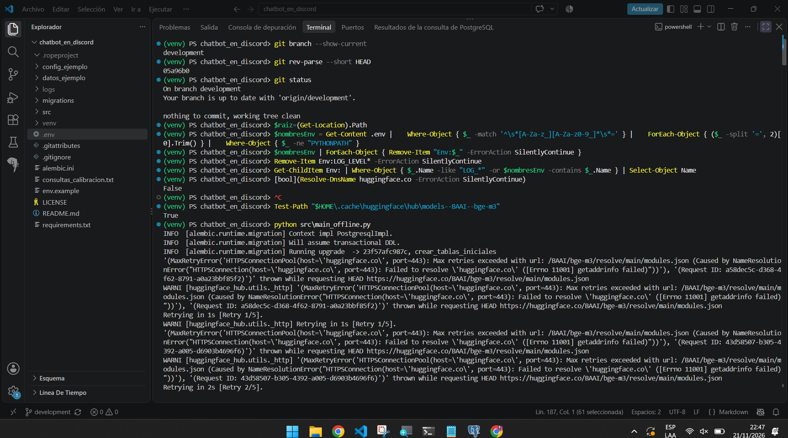

  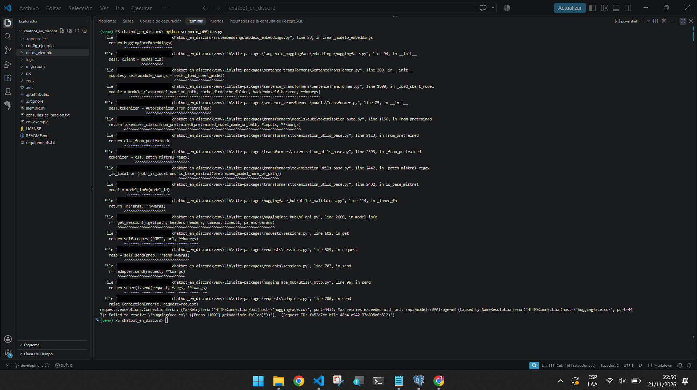

  Búsqueda de avisos de Hugging Face en los logs de esa ejecución (23:01):
  ```
  PS> $carpeta = Get-ChildItem logs -Directory -Filter "logs_*" | Sort-Object LastWriteTime -Descending | Select-Object -First 1
  PS> $carpeta.Name
  logs_21_11_26_22_35
  PS> Get-ChildItem $carpeta.FullName -Filter *.txt | Select-String -Pattern "huggingface" -SimpleMatch | Select-Object Filename, Line
  (sin salida: ninguna coincidencia)
  ```

  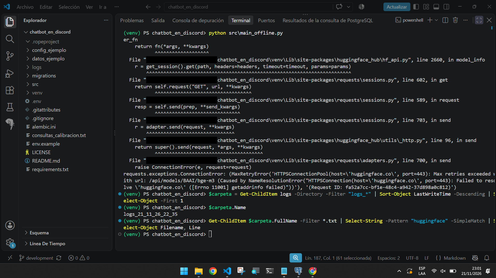

  Ejecución con el modo sin conexión (23:06 a 23:08):
  ```
  PS> $env:HF_HUB_OFFLINE = "1"
  PS> python src\main_offline.py
  INFO  [alembic.runtime.migration] Context impl PostgresqlImpl.
  INFO  [alembic.runtime.migration] Will assume transactional DDL.
  INFO  [alembic.runtime.migration] Running upgrade  -> 23f57afc987c, crear_tablas_iniciales
  PS> Remove-Item Env:HF_HUB_OFFLINE
  PS> Test-Path Env:HF_HUB_OFFLINE
  False
  ```

  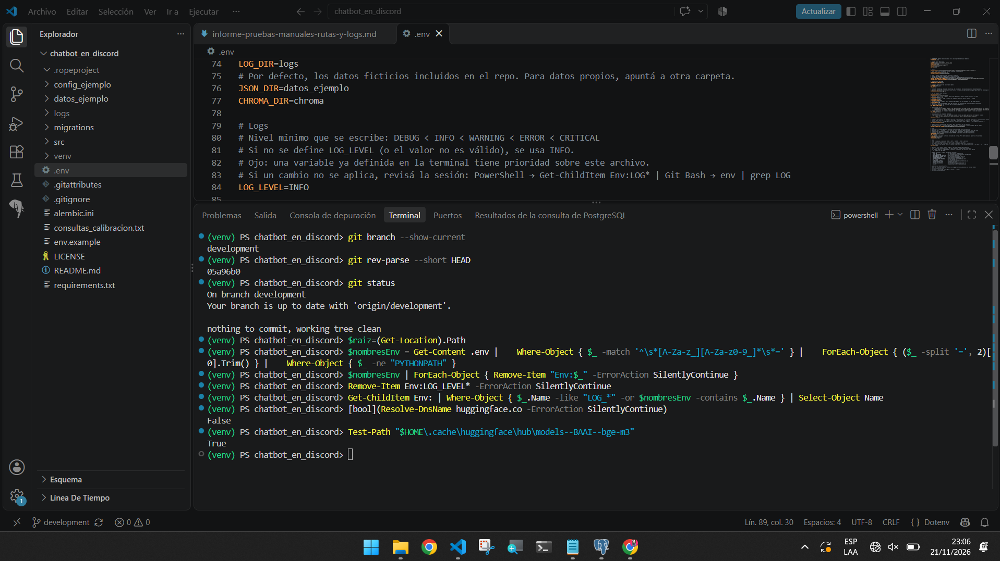

  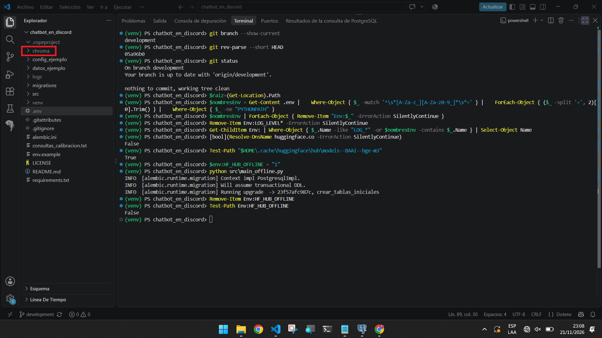

  Notas sobre las capturas:
  - Primera captura (reloj: 22:47 del 21/11/2026): se ven el paso 0 (rama `development`, commit `05a96b0`, repositorio limpio, `$raiz`), el procedimiento A (la verificación no muestra ningún nombre), el procedimiento E (`False` y `True`), la ejecución de `main_offline.py`, las tres líneas de Alembic y los primeros avisos duplicados de `huggingface_hub`. El `^C` suelto que se ve después del primer resultado de E se escribió en un prompt vacío, sin ningún programa en ejecución.
  - Segunda captura (reloj: 22:50): el final de la salida: los últimos tramos del traceback (desde `modelo_embeddings.py`, pasando por `transformers`, `huggingface_hub` y `requests`) y el `ConnectionError`, con el prompt de vuelta. Arriba figura el comando `python src\main_offline.py` (VS Code lo deja fijo mientras se desplaza la salida); la línea de `main_offline.py` (línea 84) no se ve en la captura y está en el texto de arriba.
  - Los relojes (22:47 y 22:50) indican cuándo se hicieron las capturas, después de la ejecución (22:35 a 22:39).
  - En el Explorador de ambas capturas no figura la carpeta `chroma/`: la base vectorial no llegó a crearse, coherente con el punto donde falló el programa.
  - Las barras negras de la segunda captura cubren el usuario y la carpeta personal al comienzo de cada ruta del traceback. En el texto de este informe, la ruta del proyecto se reemplaza por `<RUTA_DEL_PROYECTO>` y el traceback figura resumido.
  - Captura de la búsqueda en los logs (23:01): arriba se ve el final del traceback de la ejecución sin conexión, con barras negras sobre el usuario y la carpeta personal de las rutas; abajo, el nombre de la carpeta de logs (`logs_21_11_26_22_35`) y la búsqueda de `huggingface`, que no muestra ninguna línea.
  - Capturas del modo sin conexión: la de preparación (23:06) muestra el paso 0 (rama `development`, commit `05a96b0`, repositorio limpio, `$raiz`), los procedimientos A y E (`False` y `True`) y, en el editor, el `.env` base (`LOG_DIR=logs`, `JSON_DIR=datos_ejemplo`, `CHROMA_DIR=chroma`, `LOG_LEVEL=INFO`); en el Explorador no hay carpeta `chroma/` (procedimiento C). La de ejecución (23:08) muestra `$env:HF_HUB_OFFLINE = "1"`, la ejecución con solo las líneas de Alembic, la variable eliminada y `Test-Path` en `False`; el recuadro rojo señala la carpeta `chroma/`, que apareció. El ícono de red de la barra de tareas es distinto en estas dos capturas y en la de las 23:01 (conectado en esa).
  - Ninguna de estas capturas muestra rutas del equipo, salvo la de las 23:01, ya tapada.

**OBS-04: sin archivos JSON, el error queda solo en el log y la consola no muestra nada.**
En TC-INT-02, `main_offline.py` terminó con código de salida `1`, pero sin escribir ningún mensaje en la consola; el aviso («No se encontraron archivos JSON para procesar...») está solo en `log_procesamiento_con_preguntas_cerradas.txt`. Quien ejecuta el programa por primera vez, por ejemplo con un `JSON_DIR` mal apuntado a una carpeta vacía, ve que el programa termina sin explicación y tiene que ir a buscar el log o consultar `$LASTEXITCODE`. En cambio, con una carpeta inexistente (TC-RUT-05) sí se ve un error, aunque sea un traceback.

- **Clasificación:** mejora posible de usabilidad, no un defecto: el resultado coincide con lo esperado (el mensaje figura en el log con nivel `ERROR`). Confirmado en el código: `setup_logger` (`src/utils/utilidades_logs.py`) agrega solo un `FileHandler` y desactiva la propagación (`propagate = False`), por lo que los loggers del proyecto no escriben en la consola.
- **Acción:** evaluar, en un cambio aparte y fuera de esta ronda, mostrar también ese error en la consola Dos opciones: reemplazar `sys.exit(1)` en `main_offline.py` por `sys.exit("mensaje")` (escribe en `stderr` y termina con código `1`; conviene evitar emojis en ese texto, porque algunas consolas de Windows no los aceptan), o agregar un handler de consola para `ERROR`. Después habría que repetir TC-INT-02 en el commit nuevo.

## 13. Referencias

- ISO/IEC/IEEE 29119-3: documentación de pruebas de software (sucesora de IEEE 829).
- ISTQB: glosario estándar de términos de pruebas y programa de estudio *Foundation Level* ([istqb.org](https://istqb.org)).
